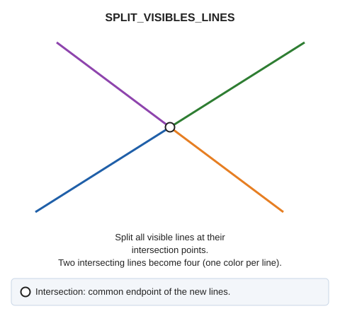

# SPLIT\_VISIBLES\_LINES
<!-- id: partir-lineas-visibles -->
<!-- origen: 69f22c8c48e3ee3c66d92e9ec4e29397e3b958ab -->

Split visible entities at their intersections.

## Parameters

Does not accept parameters.

If Digi3D.AI rejects any new portion, the command splits no lines, and all originals are preserved.

## Command characteristics

| Command type | [Immediate command](/digi3d-ai/referencia/ordenes/ordenes-no-interactivas.md) |
| :--- | :--- |
| Repeats automatically | No |
| Menu option | Geometric analysis/Divide lines at the cross point/Visible lines |
| Toolbar | _This command has no associated toolbar button_ |
| Extension | DigiNG.OrdenesTopologia.dll |
| Implementation | Native |
| Related variables | No related variables |
| Related commands | [DETECT\_VISIBLE\_LINES\_CROSSING](/digi3d-ai/referencia/ventana-de-dibujo/ordenes/d/detectar-cruce-lineas-visibles.md) [INSERT\_VERTEX\_INTERSECTION\_VISIBLE\_LINES](/digi3d-ai/referencia/ventana-de-dibujo/ordenes/i/insertar-vertice-interseccion-lineas-visibles.md) [SPIT\_LINES](/digi3d-ai/referencia/ventana-de-dibujo/ordenes/p/partir-lineas.md) |
| Internal name | {E2D27EEC-E2B6-4147-9F19-FEC8DBAF1E15} |
