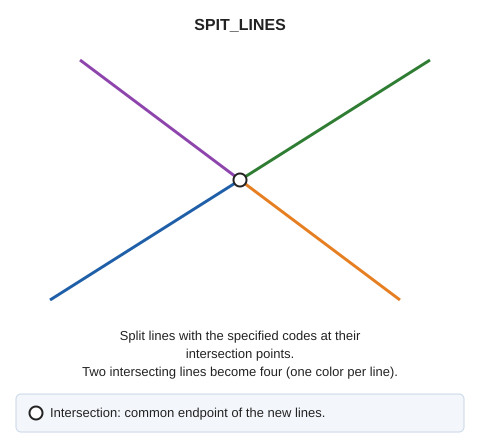

# SPIT\_LINES
<!-- id: partir-lineas -->
<!-- origen: 88e4d965bff003ba515d952bb0f65fb7e7623b02 -->

Split lines at their intersections, by code.

## Parameters

| Parameter number | Description | Optional |
| :--- | :--- | :--- |
| 1 | One or more codes, separated by spaces | Yes |

If Digi3D.AI rejects any new portion, the command splits no lines, and all originals are preserved.

## Command characteristics

| Command type | [Immediate command](/digi3d-ai/referencia/ordenes/ordenes-no-interactivas.md) |
| :--- | :--- |
| Repeats automatically | No |
| Menu option | _This command has no associated menu option_ |
| Toolbar | _This command has no associated toolbar button_ |
| Extension | DigiNG.OrdenesTopologia.dll |
| Implementation | Native |
| Related variables | No related variables |
| Related commands | [DETECT\_LINE\_CROSSING](/digi3d-ai/referencia/ventana-de-dibujo/ordenes/d/detectar-cruce-lineas.md) [INSERT\_VERTEX\_LINES\_INTERSECCION](/digi3d-ai/referencia/ventana-de-dibujo/ordenes/i/insertar-vertice-interseccion-lineas.md) [SPLIT\_VISIBLES\_LINES](/digi3d-ai/referencia/ventana-de-dibujo/ordenes/p/partir-lineas-visibles.md) |
| Internal name | {8D436538-8C23-410B-B64F-288EF7F48849} |
