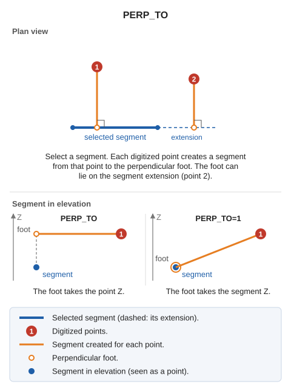

# PERP\_TO
<!-- id: perp-a -->
<!-- origen: 4ac9a49ba287a814af03d0f40b405a9e4aa07c76 -->

Draw segments perpendicular to a given entity.

## Parameters

| Parameter number | Description | Values | Optional |
| :--- | :--- | :--- | :--- |
| 1 | Elevation assignment mode for the perpendicular line | 0 or 1 | Yes |

## Notes

Without parameters, the generated line takes the elevation of the point from which the perpendicular is drawn. Pass 1 as the parameter:

PERP\_TO=1

The program assigns these elevations to the perpendicular line:

* At the endpoint from which the perpendicular is drawn, use that point's elevation.
* At the other endpoint, use the elevation of the entity to which the perpendicular is drawn.

## Command characteristics

| Command type | [Interactive command](/digi3d-ai/referencia/ordenes/ordenes-interactivas.md) |
| :--- | :--- |
| Repeats automatically | Yes |
| Menu option | Draw/More/Multiple lines with two perpendicular points to an existing line |
| Toolbar | _This command has no associated toolbar button_ |
| Extension | DigiNG.OrdenesStandard.dll |
| Implementation | Native |
| Related variables | No related variables |
| Related commands | [PERP](/digi3d-ai/referencia/ventana-de-dibujo/ordenes/p/perp.md) [PERP\_Z](/digi3d-ai/referencia/ventana-de-dibujo/ordenes/p/perp-z.md) |
| Internal name | {E2B84309-4C10-49aa-A11E-2C09AC3FFD16} |
