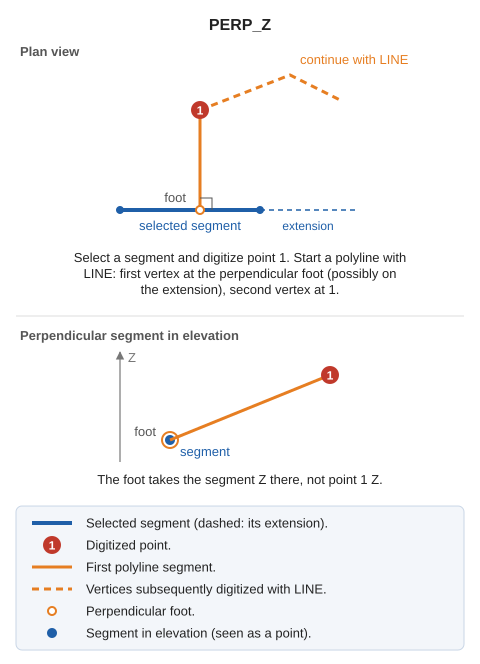

# PERP\_Z
<!-- id: perp-z -->
<!-- origen: 4802b286b0668b66409528c082ae3f86f619a28d -->

Draw lines perpendicular to a drawing entity.

## Parameters

Does not accept parameters.

## Notes

Works like [PERP](/digi3d-ai/referencia/ventana-de-dibujo/ordenes/p/perp.md), but the perpendicular foot takes Z from the selected segment rather than the digitized point.

## Command characteristics

| Command type | [Interactive command](/digi3d-ai/referencia/ordenes/ordenes-interactivas.md) |
| :--- | :--- |
| Repeats automatically | No |
| Menu option | _This command has no associated menu option_ |
| Toolbar | _This command has no associated toolbar button_ |
| Extension | DigiNG.OrdenesStandard.dll |
| Implementation | Native |
| Related variables | No related variables |
| Related commands | [PERP](/digi3d-ai/referencia/ventana-de-dibujo/ordenes/p/perp.md) [PERP\_TO](/digi3d-ai/referencia/ventana-de-dibujo/ordenes/p/perp-a.md) |
| Internal name | {C6B8AB50-A221-4239-A257-A60C99A9629D} |
