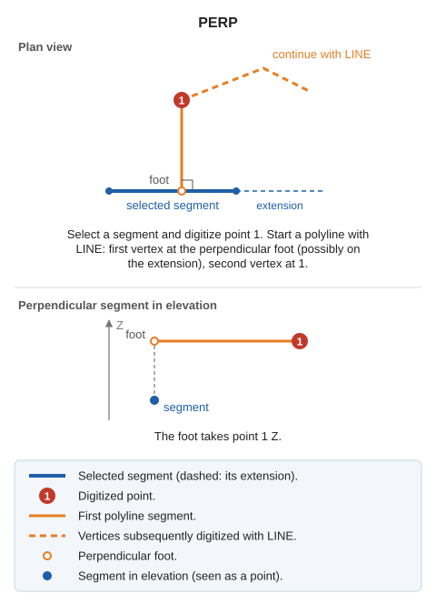

# PERP
<!-- id: perp -->
<!-- origen: 800e7277bd4c800e19f650474fa5a4489cce83c3 -->

Draw lines perpendicular to a drawing entity.

## Parameters

This command does not accept parameters.

## Notes

Select the line segment to draw a perpendicular to, then digitize a point. Start a polyline with [LINE](/digi3d-ai/referencia/ventana-de-dibujo/ordenes/l/linea.md): the first vertex is the perpendicular foot from the digitized point onto the segment's straight line (possibly on the segment extension), and the second is the digitized point. After recording these vertices, continue digitizing the polyline.

The foot takes the digitized point's Z. Use [PERP\_Z](/digi3d-ai/referencia/ventana-de-dibujo/ordenes/p/perp-z.md) to take Z from the segment instead.

## Command characteristics

| Command type | [Interactive command](/digi3d-ai/referencia/ordenes/ordenes-interactivas.md) |
| :--- | :--- |
| Repeats automatically | No |
| Menu option | Draw/Polyline where the first segment is perpendicular to a segment |
| Toolbar | Polylines |
| Extension | DigiNG.OrdenesStandard.dll |
| Implementation | Native |
| Related variables | No related variables |
| Related commands | [PERP\_TO](/digi3d-ai/referencia/ventana-de-dibujo/ordenes/p/perp-a.md) [PERP\_Z](/digi3d-ai/referencia/ventana-de-dibujo/ordenes/p/perp-z.md) |
| Internal name | {1CACF6F1-0916-4241-8791-4B91F1A7B8F4} |
