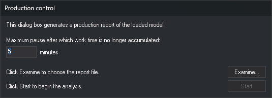

# PRODUCTION
<!-- id: produccion -->
<!-- origen: ced8f5f736cd0a760ffe7b6d4a49683547649893 -->

Generate a file with production information for the active drawing file.

## Parameters

Does not accept parameters.

## Production control dialog box

This dialog box prompts for the maximum pause and the report file:

* **Maximum pause after which work time is no longer accumulated**: in minutes (default: 5). Clicking **Start** saves the value for the next use.
* **Examine...**: opens a dialog box for saving the HTML report file, with the **Report files (\*.html)** filter. The dialog box opens in the last folder used in Digi3D.AI Open and Save dialog boxes. If the file already exists, it is overwritten without confirmation.
* **Start**: closes the dialog box and generates the report. It is disabled until you choose the file with **Examine...**.

The dialog box has no cancel button. Press Esc to close it without generating the report.

## Notes

The command calculates production from the creation date and time of undeleted lines in the active drawing file. Other entities are not considered. Two consecutive lines from the same day separated by less than the maximum pause count as work time.

The report contains:

* The name of the first loaded drawing file.
* The date and time of the first and last lines.
* Total work time.
* For each day with lines, numbered "Day 1", "Day 2", and so on, the work intervals and, in red, pauses equal to or longer than the maximum pause.

When finished, the command opens the HTML file with its associated application. If the HTML file cannot be created, the command displays an error message and finishes. If the drawing file contains no lines, the command finishes without creating a report or displaying a message.

## Command characteristics

| Command type | [Immediate command](/digi3d-ai/referencia/ordenes/ordenes-no-interactivas.md) |
| :--- | :--- |
| Repeats automatically | No |
| Menu option | _This command has no associated menu option_ |
| Toolbar | _This command has no associated toolbar button_ |
| Extension | DigiNG.OrdenesControlTrabajos.dll |
| Implementation | Native |
| Related variables | No related variables |
| Related commands | No related commands |
| Internal name | {9A3109BC-561C-426B-9776-8925DD88E866} |
