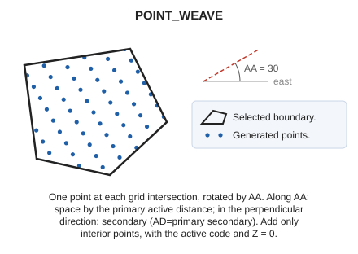

# POINT_WEAVE
<!-- id: puntear -->
<!-- origen: 8f23a6bca3abf1a182752fb87bc13e8185a895b9 -->

Fill the interior of a closed area entity with a dot pattern.

## Parameters

| Parameter number | Description | Optional |
| :--- | :--- | :--- |
| 1 | Code or codes (one or more, separated by spaces) | Yes |

Without parameters, select the closed line to fill. With codes, fill all visible closed lines bearing them and end.

## Notes

Place points at intersections of the stripes [WEAVE](/digi3d-ai/referencia/ventana-de-dibujo/ordenes/t/tramar.md) would generate:

* Along the [active angle](/digi3d-ai/referencia/ventana-de-dibujo/variables/a/aa.md), space points by the primary active distance.
* In the perpendicular direction, space them by the secondary active distance.

Set both with [AD](/digi3d-ai/referencia/ventana-de-dibujo/variables/d/da.md). Add only points inside the boundary, with the active code and Z = 0. The active code must be for point entities.

## Command characteristics

| Command type | [Interactive command](/digi3d-ai/referencia/ordenes/ordenes-interactivas.md) |
| :--- | :--- |
| Repeats automatically | Yes |
| Menu option | Draw/More/Fill polygon with points |
| Toolbar | _This command has no associated toolbar button_ |
| Extension | DigiNG.OrdenesStandard.dll |
| Implementation | Native |
| Related variables | [AA](/digi3d-ai/referencia/ventana-de-dibujo/variables/a/aa.md) — active angle [AD](/digi3d-ai/referencia/ventana-de-dibujo/variables/d/da.md) — active distance [REPEAT](/digi3d-ai/referencia/ventana-de-dibujo/variables/r/repite.md) — repeat the last command executed |
| Related commands | [SCRATCH](/digi3d-ai/referencia/ventana-de-dibujo/ordenes/r/rayar.md) [SIMB](/digi3d-ai/referencia/ventana-de-dibujo/ordenes/s/simb.md) [WEAVE](/digi3d-ai/referencia/ventana-de-dibujo/ordenes/t/tramar.md) |
| Internal name | {EED3B1FD-0000-4c24-BBF9-33DEC81BF1D0} |
