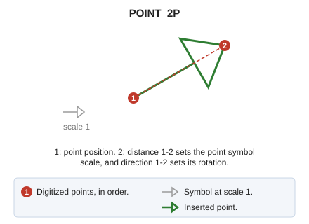

# POINT\_2P
<!-- id: punto-2p -->
<!-- origen: 996a0f84b75d167a9ec4edb8f6e1df5accf04d40 -->

Draw a point in the current file with its scale and rotation calculated from the second digitized point.

## Parameters

Does not accept parameters.

## Notes

1. Digitize the point position.
2. Digitize a second point. The distance between the points is the point symbol's scale, and the direction from the first to the second is its rotation.

## Command characteristics

| Command type | [Immediate command](/digi3d-ai/referencia/ordenes/ordenes-no-interactivas.md) |
| :--- | :--- |
| Repeats automatically | Yes |
| Menu option | Draw/Point scaled/rotated with two points |
| Toolbar | Points |
| Extension | DigiNG.OrdenesStandard.dll |
| Implementation | Native |
| Related variables | [REPEAT](/digi3d-ai/referencia/ventana-de-dibujo/variables/r/repite.md) — repeat the last command executed |
| Related commands | [POINT](/digi3d-ai/referencia/ventana-de-dibujo/ordenes/p/punto.md) [R\_POINT](/digi3d-ai/referencia/ventana-de-dibujo/ordenes/p/punto-r.md) |
| Internal name | {35AE7D6E-2A1D-4C67-873C-109C7D0F8394} |
