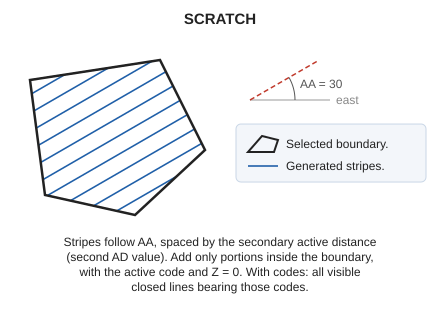

# SCRATCH
<!-- id: rayar -->
<!-- origen: cc3d656fc708b68e66e1260b5259d692fec5c0e2 -->

Hatch the interior of a closed area entity with parallel lines.

## Parameters

| Parameter number | Description | Optional |
| :--- | :--- | :--- |
| 1 | Code or codes (one or more, separated by spaces) | Yes |

Without parameters, select the closed line to hatch. With codes, hatch all visible closed lines bearing them and end.

## Notes

Stripes follow the [active angle](/digi3d-ai/referencia/ventana-de-dibujo/variables/a/aa.md) and are spaced by the secondary active distance, set with [AD](/digi3d-ai/referencia/ventana-de-dibujo/variables/d/da.md)'s second parameter. With one AD value, the secondary distance equals the primary.

Add only stripe portions inside the boundary, with the active code and Z = 0.

## Command characteristics

| Command type | [Interactive command](/digi3d-ai/referencia/ordenes/ordenes-interactivas.md) |
| :--- | :--- |
| Repeats automatically | Yes |
| Menu option | Draw/More/Fill polygon with parallel stripes |
| Toolbar | _This command has no associated toolbar button_ |
| Extension | DigiNG.OrdenesStandard.dll |
| Implementation | Native |
| Related variables | [AA](/digi3d-ai/referencia/ventana-de-dibujo/variables/a/aa.md) — active angle [AD](/digi3d-ai/referencia/ventana-de-dibujo/variables/d/da.md) — active distance [REPEAT](/digi3d-ai/referencia/ventana-de-dibujo/variables/r/repite.md) — repeat the last command executed |
| Related commands | [POINT_WEAVE](/digi3d-ai/referencia/ventana-de-dibujo/ordenes/p/puntear.md) [SIMB](/digi3d-ai/referencia/ventana-de-dibujo/ordenes/s/simb.md) [WEAVE](/digi3d-ai/referencia/ventana-de-dibujo/ordenes/t/tramar.md) |
| Internal name | {91CEE0AF-E015-4d1e-A414-9250FAD17CCC} |
