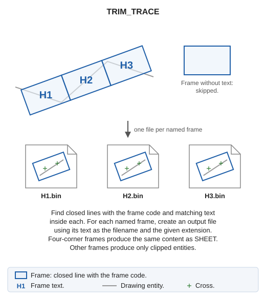
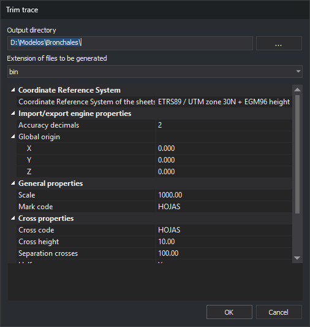

# TRIM\_TRACE
<!-- id: recorta-traza -->
<!-- origen: 96b78304a02d685be722f5d7bf59b7f16bf0ceb0 -->

Create one drawing file for each sheet index frame, such as those created by [TRACE](/digi3d-ai/referencia/ventana-de-dibujo/ordenes/t/traza.md). Each filename is the text inside its frame.

## Parameters

Without parameters, **Trim trace** opens. Otherwise, at least these 12 parameters are required, in this order:

| Parameter number | Description | Values |
| :--- | :--- | :--- |
| 1 | Output directory | Existing directory for created files |
| 2 | Output file extension | Writable Digi3D.AI format extension without a period, such as `bin` |
| 3 | Format parameters | Parameters for that extension, quoted. For `bin`: precision, global origin X, global origin Y, global origin Z |
| 4 | Scale | Number greater than 0 |
| 5 | Frame code | Code of frames and sheet name text |
| 6 | Cross code | Code |
| 7 | Cross height | Paper mm |
| 8 | Cross spacing | Paper mm, greater than 0 |
| 9 | Half crosses | 1 to add them, 0 otherwise |
| 10 | Coordinate code | Coordinate label code |
| 11 | Coordinate height | Paper mm |
| 12 | Coordinate decimal places | Integer |

Syntax:

TRIM\_TRACE=\[output directory\] \[extension\] \[format parameters\] \[scale\] \[frame code\] \[cross code\] \[cross height\] \[cross spacing\] \[half crosses\] \[coordinate code\] \[coordinate height\] \[decimal places\]

Quote format parameters so they count as a single command parameter. For `bin`, precision is the decimal places used to save coordinates: 2 for centimeters, 3 for millimeters.

### Example

`TRIM_TRACE="c:\trabajo\x" bin "2 0.0 0.0 0.0" 1000 HOJAS HOJAS 10 100 1 HOJAS 2 2`

In parameter mode, an error appears and nothing is created if:

* Fewer than 12 parameters are supplied.
* The output directory does not exist.
* Scale or cross spacing is not greater than 0.
* No writable format has the extension, or that format has no parameters.
* The format does not recognize its parameters. The message shows the expected syntax.

In parameter mode, sheets use the drawing window coordinate reference system.

## Notes

### Frames and sheet names

The active drawing file is searched for:

* Frames: visible closed lines with the frame code inside the area of interest.
* Text with the frame code. Each frame uses the first text in file order whose insertion point is inside or on it. Each text names only one frame.

Frames with no text or empty text are skipped. If no frame is found, **No sheet frame line has been found.** appears, the error sound plays, and the command ends.

For each named frame, create `<texto>.<extensión>` in the output directory: text `H1` and extension `bin` produce `H1.bin`. Existing files are overwritten without confirmation. Identically named frames cause the second file to replace the first.

During processing, the command line shows **Creating the sheet: \<file\>...** for each sheet.

### File content

Content depends on frame vertex count.

**Five-vertex frame** (four corners and closure, as in TRACE): create a sheet as [SHEET](/digi3d-ai/referencia/ventana-de-dibujo/ordenes/h/hoja.md), with vertices 1–4 as bottom-left, bottom-right, top-right, and top-left corners:

* Frame with the frame code.
* Crosses, half crosses, and coordinate labels using their configured properties.
* Entities clipped to the frame.
* A `.utm` file beside the drawing file containing the four corner coordinates. Failure to create it shows an error in the Tasks pane, but the sheet is still created.

Crosses, half crosses, and labels follow the X and Y axes. A rotated TRACE frame follows the axis, but marks are not rotated.

**Other vertex counts**: only clipped entities are written, without frame, crosses, labels, or `.utm`. Scale and cross and coordinate properties are unused.

Clipped entities come from loaded drawing files, are visible and inside the area of interest, and exclude disabled codes:

* Lines clipped to the frame, copying interior pieces.
* Points and text with insertion points inside the frame.
* Polygons, complex entities, multipoints, and images entirely inside the frame. Those crossing it are not copied.

The drawing file is unchanged, so there is nothing to undo. Created files are not opened.

### Sheet creation errors

If a sheet file cannot be created, for example due to invalid filename characters in its text or a file locked by another application, **Error when creating the sheet** is added to the Tasks pane with filename and reason, and processing continues with the next sheet. Format write or publish failures also appear there. Any failed sheet causes the error sound at completion. If all succeed, the command line shows **Work concluded satisfactorily**.

## Trim trace dialog

* **Output directory**: folder for created files. **...** opens folder selection. Initially the active drawing file directory.
* **Extension of files to be generated**: format, listing extensions Digi3D.AI can write.
* **Coordinate Reference System**
  * **Coordinate Reference System of the sheets to be created**: system assigned to each file, initially the drawing window system. Local systems show **Unknown**. **...** opens system selection. For `bin`, a `.prj` beside each sheet stores it; an existing `.prj` retains its system.
* **Import/export engine properties**: chosen format parameters, changing with the extension. For `bin`: **Precision decimals** and **Global origin** X, Y, Z.
* **General properties**
  * **Scale**: enter or select sheet scale, greater than 0.
  * **Mark code**: frame and sheet name code to search, and output frame code for five-vertex sheets.
* **Cross properties**
  * **Cross code**: cross and half cross code.
  * **Cross height**: cross stroke length in paper mm.
  * **Separation crosses**: spacing in paper mm, greater than 0.
  * **Half crosses**: add half crosses and labels at frame edges.
* **Coordinate properties**
  * **Coordinate code**: coordinate label code.
  * **Coordinate height**: label height in paper mm.
  * **No. of decimals**: corner label decimals and, without half crosses, all label decimals.

Ground measurements equal paper value × scale ÷ 1000: at scale 1000 and spacing 100, crosses are 100 m apart.

**OK** validates values. A nonexistent output directory, scale or spacing not greater than 0, or format without parameters produces a message and leaves the dialog open without saving. Valid extension, general, cross, and coordinate properties are saved under registry key `HKEY_CURRENT_USER\Software\Digi21\Digi3D.NET\DigiNG\Extensiones\DigiNG.OrdenesStandard\RecortarTraza`, then sheets are created. Saved values appear next run. Output directory, coordinate reference system, and format parameters are not saved.

Initially, extension is the second listed; scale is the configured Digi3D.AI scale or 1000 if none; cross height is 10 paper mm, spacing 100 paper mm, coordinate height 2 paper mm; frame, cross, and coordinate codes are `HOJAS`; half crosses are enabled; coordinate decimal places are 2.

**Cancel** ends without creating anything or saving values.

## Command characteristics

| Command type | [Interactive command](/digi3d-ai/referencia/ventana-de-dibujo/ordenes-interactivas.md) |
| :--- | :--- |
| Repeats automatically | No |
| Menu option | Draw/Sheet index/Create sheets from a sheet index |
| Toolbar | _This command has no associated toolbar button_ |
| Extension | DigiNG.OrdenesStandard.dll |
| Implementation | Native |
| Related variables | No related variables |
| Related commands | [SHEET](/digi3d-ai/referencia/ventana-de-dibujo/ordenes/h/hoja.md) [TRACE](/digi3d-ai/referencia/ventana-de-dibujo/ordenes/t/traza.md) |
| Internal name | {B066D261-DFE7-4c27-AFAC-CECD7B76D3C2} |
