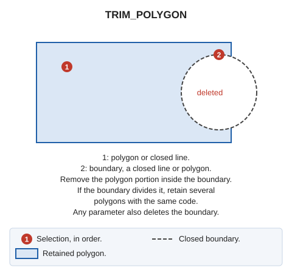

# TRIM\_POLYGON
<!-- id: recortar-poligono -->
<!-- origen: 6b6f4e420475ff6b7478dd293a9d1ab8e236ac22 -->

Trim a polygon by removing the portion intersecting a boundary.

## Parameters

| Parameter number | Description | Values | Optional |
| :--- | :--- | :--- | :--- |
| 1 | Delete the boundary line | Any value, such as 1 | Yes |

## Notes

Select the polygon to trim. Only _polygon_ entities and closed _line_ entities can be selected.  
Select the boundary entity: a closed line or polygon. For a polygon boundary, use its exterior boundary and ignore its holes.

Analyze the intersection between the polygon to trim and the boundary entity, and create one or more polygons \(the boundary line can divide the polygon into several portions\).

## Command characteristics

| Command type | [Interactive command](/digi3d-ai/referencia/ordenes/ordenes-interactivas.md) |
| :--- | :--- |
| Repeats automatically | No |
| Menu option | Edit/Polygons/Trim polygon |
| Toolbar | _This command has no associated toolbar button_ |
| Extension | DigiNG.Commands.dll |
| Implementation | [.NET](/digi3d-ai/programacion/.net/README.md) |
| Source code | [RecortarPoligono.cs](https://github.com/digi21/DigiNG.Commands/blob/main/DigiNG.Commands/Operaciones%20con%20entidades/RecortarPoligono.cs) |
| Related variables | No related variables |
| Related commands | [CUT\_POLYGON](/digi3d-ai/referencia/ventana-de-dibujo/ordenes/c/cortar-poligono.md) [TRIM\_POLYGONS](/digi3d-ai/referencia/ventana-de-dibujo/ordenes/r/recortar-poligonos.md) |
