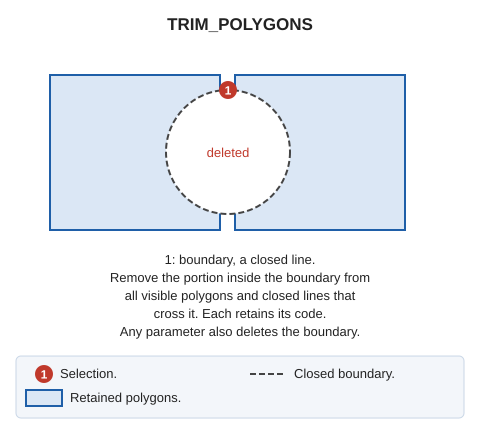

# TRIM\_POLYGONS
<!-- id: recortar-poligonos -->
<!-- origen: 7451b506e3c47e4a0a9748a566d961e55f2e19b0 -->

Trim all polygons intersecting a boundary.

## Parameters

| Parameter number | Description | Values | Optional |
| :--- | :--- | :--- | :--- |
| 1 | Delete the boundary line | Any value, such as 1 | Yes |

## Notes

Select a closed line as the trimming boundary.

Analyze intersections between the selected line and visible polygons \(polygon entities or closed _line_ entities\), and remove the portions intersecting the selected boundary. A polygon can be trimmed into multiple portions if the boundary divides it completely.

## Command characteristics

| Command type | Interactiva |
| :--- | :--- |
| Repeats automatically | No |
| Menu option | Edit/Polygons/Trim polygons |
| Toolbar | _This command has no associated toolbar button_ |
| Extension | DigiNG.Commands.dll |
| Implementation | [.NET](/digi3d-ai/programacion/.net/README.md) |
| Source code | [RecortarPoligonos.cs](https://github.com/digi21/DigiNG.Commands/blob/main/DigiNG.Commands/Operaciones%20con%20entidades/RecortarPoligonos.cs) |
| Related variables | No related variables |
| Related commands | [CUT\_POLYGON](/digi3d-ai/referencia/ventana-de-dibujo/ordenes/c/cortar-poligono.md) [TRIM\_POLYGON](/digi3d-ai/referencia/ventana-de-dibujo/ordenes/r/recortar-poligono.md) |
