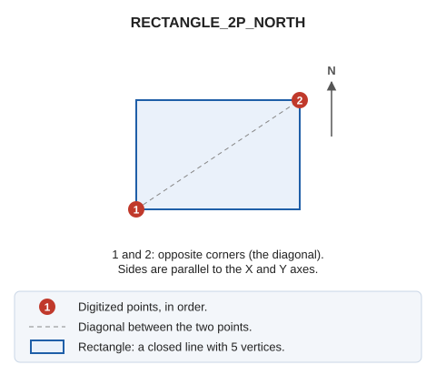

# RECTANGLE\_2P\_NORTH
<!-- id: rectangulo-2p-norte -->
<!-- origen: 8e5fc4f8fa4c477e15efa488adb6dd42efe70998 -->

Draw a north-oriented rectangle defined by two diagonally opposite points.

## Parameters

Does not accept parameters.

## Command characteristics

| Command type | [Interactive command](/digi3d-ai/referencia/ordenes/ordenes-interactivas.md) |
| :--- | :--- |
| Repeats automatically | No |
| Menu option | Draw/More/Rectangle with 2 points oriented north |
| Toolbar | Squares and rectangles |
| Extension | DigiNG.OrdenesStandard.dll |
| Implementation | Native |
| Related variables | No related variables |
| Related commands | [2P](/digi3d-ai/referencia/ventana-de-dibujo/ordenes/2/2p.md) [2P\_AA](/digi3d-ai/referencia/ventana-de-dibujo/ordenes/2/2p-aa.md) [3P](/digi3d-ai/referencia/ventana-de-dibujo/ordenes/3/3p.md) [RECTANGLE\_DR](/digi3d-ai/referencia/ventana-de-dibujo/ordenes/r/rectangulo-dr.md) |
| Internal name | {EDBBB1EB-6305-4E55-9A05-BEEDE794D376} |
