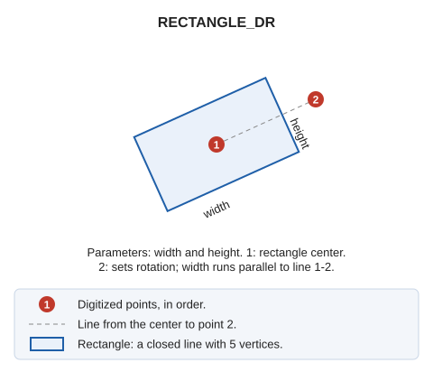

# RECTANGLE\_DR
<!-- id: rectangulo-dr -->
<!-- origen: 07d4486f24dc486a62fe09f613510a6c9d676b89 -->

Digitize a rectangle with the specified dimensions and rotate it as needed.

## Parameters

| Parameter number | Description | Optional |
| :--- | :--- | :--- |
| 1 | Width | No |
| 2 | Height | No |

## Notes

The first point you digitize is the **center** of the rectangle. The second point sets its rotation: the width is parallel to the line joining the two points.

## Command characteristics

| Command type | [Interactive command](/digi3d-ai/referencia/ordenes/ordenes-interactivas.md) |
| :--- | :--- |
| Repeats automatically | Yes |
| Menu option | _This command has no associated menu option_ |
| Toolbar | _This command has no associated toolbar button_ |
| Extension | DigiNG.OrdenesStandard.dll |
| Implementation | Native |
| Related variables | [REPEAT](/digi3d-ai/referencia/ventana-de-dibujo/variables/r/repite.md) — repeat the last command executed |
| Related commands | [2P](/digi3d-ai/referencia/ventana-de-dibujo/ordenes/2/2p.md) [2P\_AA](/digi3d-ai/referencia/ventana-de-dibujo/ordenes/2/2p-aa.md) [3P](/digi3d-ai/referencia/ventana-de-dibujo/ordenes/3/3p.md) [RECTANGLE\_2P\_NORTH](/digi3d-ai/referencia/ventana-de-dibujo/ordenes/r/rectangulo-2p-norte.md) |
| Internal name | {D1327156-0A55-43D3-AB1B-62397E5D90EF} |
