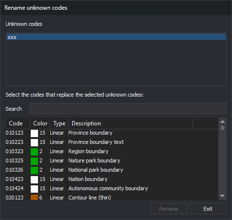

# RENAME\_UNKNOWN\_CODES
<!-- id: renombrar-codigos-desconocidos -->
<!-- origen: 1f20512c86f82f2fea4801ec7ee52b26120a4a63 -->

Replace unknown codes on entities in the active drawing file with codes from the code table.

## Parameters

Does not accept parameters.

## Notes

A code is unknown when it is not defined in the code table, for example, because the drawing file was created with a different table. The command searches for unknown codes on undeleted entities in the active drawing file. It does not search other loaded drawing files.

To remove unknown codes without replacing them, use [DELETE\_UNKNOWN\_CODES](/digi3d-ai/referencia/ventana-de-dibujo/ordenes/e/eliminar-codigos-desconocidos.md).

### Dialog box

Running the command displays the _Rename unknown codes_ dialog box:

| Field | Description |
| :--- | :--- |
| Unknown codes | Unknown codes in the active drawing file, sorted alphabetically without duplicates. Each click selects or deselects a code, allowing you to select several without holding any key |
| Search | Filter the table's code list. See [Search](#search) |
| Code list | Codes from the code table, with their color, type (point, linear, or virtual), and description. Hold **Ctrl** or **Shift** while clicking to select several |

If the active drawing file has no unknown codes, the _Unknown codes_ list is empty, and the _Search_ field and code list are disabled.

### Search

The _Search_ field filters the code list as you type:

* Text displays codes starting with that text and codes whose descriptions contain it. Matching is case-sensitive for codes, and `?` replaces any single character. Matching is case-insensitive for descriptions.
* Text starting with `#` displays codes assigned the [tag](/digi3d-ai/referencia/editor-de-tablas-de-codigos/pestanas/codigos/propiedades-del-codigo.md#tags) that follows, case-insensitively. For example, `#hidrografia`.
* An empty field displays all codes.

Changing the text clears the code list's selection.

### Rename codes

The _Rename_ button is enabled when at least one code is selected in _Unknown codes_ and one in the code list. Clicking it processes each undeleted entity in the active drawing file with any selected unknown code:

* Remove the selected unknown codes from the entity.
* Retain its other codes in the same order, including unknown codes you did not select.
* Append the codes selected in the code list that the entity does not already have.

If you select several table codes, each entity receives all of them and has multiple codes. If you select several unknown codes, they are all replaced by the same codes.

The command does not modify the entity in the file: it deletes it and appends a copy with the new codes to the drawing file. The copy retains the original entity's geometry, color, thickness, and attributes.

After renaming, the dialog box remains open. The drawing window is refreshed, and the _Unknown codes_ list is recalculated: renamed codes disappear from it, and no code remains selected. The code list retains its filter and selection.

Click _Exit_ to close the dialog box and end the command. _Exit_ does not undo completed renaming operations.

[UNDO](/digi3d-ai/referencia/ventana-de-dibujo/ordenes/u/undo.md) undoes all renaming performed while the dialog box was open at once.

Each entity is handled independently: if Digi3D.AI rejects an entity with the new code, the corresponding original entity is preserved unchanged; new codes are assigned to entities whose changes are accepted.

## Command characteristics

| Command type | Immediate command |
| :--- | :--- |
| Repeats automatically | No |
| Menu option | Edit/Rename unknown codes... |
| Toolbar | _This command has no associated toolbar button_ |
| Extension | DigiNG.OrdenesStandard.dll |
| Implementation | Native |
| Related variables | No related variables |
| Related commands | [DELETE\_UNKNOWN\_CODES](/digi3d-ai/referencia/ventana-de-dibujo/ordenes/e/eliminar-codigos-desconocidos.md) [RENAMCOD](/digi3d-ai/referencia/ventana-de-dibujo/ordenes/r/renomcod.md) [UNDO](/digi3d-ai/referencia/ventana-de-dibujo/ordenes/u/undo.md) |
| Internal name | {4B10E14D-3CF6-4CD3-975F-EE1544AA3C72} |
