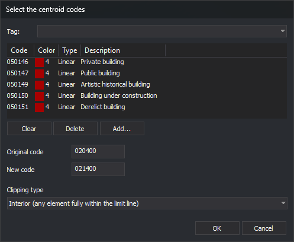

# RENAMCOD\_E
<!-- id: renomcod-r -->
<!-- origen: b6329e56682d737bdf11508f86e2b5c1143602d2 -->

Replace one code with another on entities in the active drawing file inside enclosures of loaded topologies whose centroids have any selected code. Lines crossing an enclosure boundary can be clipped to it.

## Parameters

Does not accept parameters.

## Notes

The command works with topologies loaded using [BINTOP](/digi3d-ai/referencia/ventana-de-dibujo/ordenes/b/bintop.md). If none are loaded, it sounds an error tone, displays _There is no topology file loaded_, and ends.

### Dialog box

Running the command displays the _Select the centroid codes_ dialog box:

| Field | Description | Default value |
| :--- | :--- | :--- |
| Code list | Centroid codes. Only enclosures whose centroids have any of these codes are processed | _Empty_ |
| Original code | Code to replace. Supports wildcards (`*`, `?`) | _Empty_ |
| New code | Replacement code. A `?` retains the character at that position in the original code, and a `*` retains the rest of the original code | _Empty_ |
| Clipping type | Which entities are considered inside the enclosure. See [Clipping types](#clipping-types) | Interior |

_OK_ is only enabled when the list contains at least one code and _Original code_ and _New code_ are not empty. Clicking _OK_ saves both codes and the clipping type in the `CodA`, `CodB`, and `TipoInclusion` values under the registry key `HKEY_CURRENT_USER\Software\Digi21\Digi3D.NET\DigiNG\Extensiones\DigiNG.OrdenesTopologia\RenomcodR`. The next time you run the command, the dialog box displays these values. Click _Cancel_ to end the command without changes.

### Entities processed

The command only processes entities in the active drawing file that:

* Have the original code.
* Are visible and within the area of interest.
* Are neither arcs nor centroids of any loaded topology.

For each processed entity, the command replaces every code matching the original code and retains all other codes. The new code does not retain the original code's database link.

### Enclosures and holes

The command iterates over enclosures in all loaded topologies and processes those whose centroids have any code in the list. An enclosure is clipped using its exterior boundary and its hole boundaries: what lies inside an island is outside the enclosure. If the island is itself an enclosure with one of those centroids, the command processes it as another enclosure. An entity lying exactly on the boundary is considered inside.

### Clipping types

| Type | Lines | Polygons and complex entities | Points and texts |
| :--- | :--- | :--- | :--- |
| Interior | Change the code on lines with all vertices inside. Lines crossing the boundary are unchanged | Change the code on those completely inside | Change the code if the insertion point is inside |
| Cut | Clip lines crossing the boundary: inside portions receive the new code, and outside portions retain the original. Lines completely inside change code | Unchanged | Change the code if the insertion point is inside |
| Overlap | Change the code on the entire line if at least one vertex is inside | Change the code on any with at least one vertex inside | Change the code if the insertion point is inside |

_Interior_ and _Overlap_ decide by vertices: a line with all vertices inside the enclosure counts as interior even if one of its segments crosses an island.

### End of the command

When finished, the command refreshes the view, sounds the end-of-command tone, and displays a message with the number of processed enclosures, entities whose codes changed as a whole, and clipped lines. If no enclosure has a centroid with any code in the list, it sounds an error tone, displays _No enclosure of the loaded topologies has a centroid with any of the selected codes._, and changes nothing.

The command does not unload the topology: arcs and centroids are unchanged.

[UNDO](/digi3d-ai/referencia/ventana-de-dibujo/ordenes/u/undo.md) undoes all changes from the command at once.

If Digi3D.AI rejects any new portions of lines clipped by an enclosure, those lines are preserved without clipping, and no portions are added. Other enclosures are processed normally. If it rejects an entity inside with the new code, its original is preserved.

## Command characteristics

| Command type | Immediate command |
| :--- | :--- |
| Repeats automatically | No |
| Menu option | _This command has no associated menu option_ |
| Toolbar | _This command has no associated toolbar button_ |
| Extension | DigiNG.OrdenesTopologia.dll |
| Implementation | Native |
| Related variables | No related variables |
| Related commands | [BINTOP](/digi3d-ai/referencia/ventana-de-dibujo/ordenes/b/bintop.md) [DELETE\_ENCLOSURE](/digi3d-ai/referencia/ventana-de-dibujo/ordenes/b/borra-r.md) [CHNG\_COD\_E](/digi3d-ai/referencia/ventana-de-dibujo/ordenes/c/camb-cod-r.md) [RENAMCOD](/digi3d-ai/referencia/ventana-de-dibujo/ordenes/r/renomcod.md) [RENAMCOD\_SEL](/digi3d-ai/referencia/ventana-de-dibujo/ordenes/r/renomcod-sel.md) [UNDO](/digi3d-ai/referencia/ventana-de-dibujo/ordenes/u/undo.md) |
| Internal name | {ED48B9FA-78F6-4E31-A6E4-5237BD4BA9C8} |
