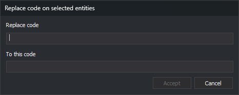

# RENAMCOD\_SEL
<!-- id: renomcod-sel -->
<!-- origen: bf05b8f7fe1a7b2f9ac180a4ccb5a819be3a01da -->

Replace one code with another on the entities you select.

## Parameters

| Parameter number | Description | Optional |
| :--- | :--- | :--- |
| 1 | Code to replace | Yes |
| 2 | New code | Yes |

## Notes

### Codes

Without parameters, the command displays the _Replace code on selected entities_ dialog box immediately, before any entities are selected:

| Field | Description |
| :--- | :--- |
| Replace code | Code to replace |
| To this code | New code |

The dialog box does not suggest any codes: both fields are empty. _Accept_ is disabled while either field is empty. Click _Cancel_ to end the command without changes.

If you supply both parameters, the command skips the dialog box. If you supply only one, it sounds an error tone and ends. Parameters after the second are ignored.

Both codes support `*` and `?` wildcards. The new code is combined, position by position, with each matching code on the entity, as in [RENAMCOD](/digi3d-ai/referencia/ventana-de-dibujo/ordenes/r/renomcod.md):

* A character in the new code replaces the character at that position in the entity's code.
* `?` retains the character from the entity's code.
* `*` retains the rest of the entity's code.

If the new code is not in the code table, the command assigns it anyway.

### Select entities

After the dialog box, or immediately if you supplied parameters, the command line displays _Select an entity or entities to rename their codes_. The command does not use entities selected before it was run.

* **Single selection:** select an entity with the data or snap pedal. The command runs [SNAP](/digi3d-ai/referencia/barras-de-herramientas/tentativo.md) with the string `LPTBGH*@`, which selects lines, points, texts, images, complex entities, and polygons from the active drawing file. If the entity does not belong to the active drawing file, the command sounds an error tone and continues waiting.
* **Multiple selection:** use a multiple selection command, such as [SELECT\_WINDOW](/digi3d-ai/referencia/ventana-de-dibujo/ordenes/s/selecciona-ventana.md). The command ignores deleted entities and those outside the active drawing file.

### Change codes

For each selected entity, the command replaces all codes matching the code to replace. Entities without that code do not change. The command marks each modified entity as deleted and adds a copy with the new codes.

The new code does not retain the replaced code's database attributes. RENAMCOD's _DB attributes of the target code_ setting does not affect this command.

The command ends after processing the first selection, even if no entity had the code. [UNDO](/digi3d-ai/referencia/ventana-de-dibujo/ordenes/u/undo.md) undoes the change.

If you supply parameters and [REPEAT](/digi3d-ai/referencia/ventana-de-dibujo/variables/r/repite.md) is enabled, the command repeats with the same codes. If you specify codes in the dialog box, the command does not repeat.

Each entity is handled independently: if Digi3D.AI rejects an entity with the new code, the corresponding original entity is preserved unchanged; new codes are assigned to entities whose changes are accepted.

## Command characteristics

| Command type | [Interactive command](/digi3d-ai/referencia/ordenes/ordenes-interactivas.md) |
| :--- | :--- |
| Repeats automatically | Only when parameters are supplied |
| Menu option | Edit/Rename one code of the selected entities... |
| Toolbar | _This command has no associated toolbar button_ |
| Extension | DigiNG.OrdenesStandard.dll |
| Implementation | Native |
| Related variables | [REPEAT](/digi3d-ai/referencia/ventana-de-dibujo/variables/r/repite.md) — repeat the last command executed |
| Related commands | [RENAMCOD](/digi3d-ai/referencia/ventana-de-dibujo/ordenes/r/renomcod.md) [RENAMCOD\_E](/digi3d-ai/referencia/ventana-de-dibujo/ordenes/r/renomcod-r.md) [UNDO](/digi3d-ai/referencia/ventana-de-dibujo/ordenes/u/undo.md) |
| Internal name | {BB0F09E4-995F-4B4F-9B87-EDE43791C8B6} |
