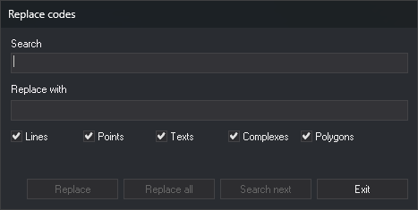

# RENAMCOD
<!-- id: renomcod -->
<!-- origen: 6c9279552bc6f7ae025629655689e88a6fe91ffd -->

Replace one code with another on entities in the active drawing file. Specify both codes as parameters or in the _Replace codes_ dialog box.

## Parameters

| Parameter number | Description | Values | Optional |
| :--- | :--- | :--- | :--- |
| 1 | Code to find | Code. Supports `*` and `?` wildcards | Yes |
| 2 | New code | Code. Supports `*` and `?` wildcards | Yes |
| 3 | [Geometry type](/digi3d-ai/referencia/ventana-de-dibujo/tipos-de-geometria.md) | String of letters: `L` lines, `P` points and point-based complex entities, `C` lines and points, `T` texts, `G` complex entities, `H` polygons, `B` images. `*` includes all types, including those without a letter, such as multipoints | Yes |

If you do not supply all three parameters, the command displays the _Replace codes_ dialog box and ignores any parameters you supplied.

## Notes

### Entities processed

The command only processes entities in the active drawing file that meet all these conditions:

* They are visible and within the area of interest.
* They are not deleted, unless [DELETED](/digi3d-ai/referencia/ventana-de-dibujo/variables/b/borrados.md) is enabled.
* They are of one of the specified types.
* They have at least one code matching the code to find.

If an entity has several codes, the command replaces all matching codes and retains the others.

The command does not modify the entity: it deletes it and appends a copy with the new code to the drawing file.

### Wildcards

Both codes support `*` and `?` wildcards. The new code is combined, position by position, with each code matching the code to find:

* A character in the new code replaces the character at that position in the entity's code.
* `?` retains the character from the entity's code.
* `*` retains the rest of the entity's code.
* If the new code does not end in `*`, the result has the new code's length: code `020124` with new code `02?` produces `020`.
* If a `?` falls at a position not present in the entity's code, the result ends there: `A` with `A?C` produces `A`.

For example, `RENAMCOD=02* 0211* *` changes `020124` to `021124`.

### New code and database attributes

If the new code does not exist in the code table, the command assigns it anyway, leaving the entity with an unknown code. To replace those codes later, run [RENAME\_UNKNOWN\_CODES](/digi3d-ai/referencia/ventana-de-dibujo/ordenes/r/renombrar-codigos-desconocidos.md).

The [DB attributes of the target code](/digi3d-ai/referencia/cuadros-de-dialogo/configuracion/renomcod/atributos-de-bbdd-del-codigo-destino.md) setting specifies how the new code's attributes are populated. Only the third option copies non-null values from the replaced code. If the new code has no database table, the entity loses the replaced code's attributes.

### Run with parameters

The command displays _Renaming the code: code to find by new code_ on the command line, along with the percentage of entities examined. It then deletes the original entities, adds the copies, and beeps.

### Dialog box

The _Replace codes_ dialog box has these fields and checkboxes:

| Field | Description |
| :--- | :--- |
| Search | Code to find. Supports wildcards |
| Replace with | New code. Supports wildcards |
| Lines, Points, Texts, Complexes, Polygons | Entity types to process. The _Points_ checkbox includes point-based complex entities. Images and multipoints have no checkbox and are always processed |

When the dialog box opens, both fields are empty, and all five checkboxes are selected. The dialog box saves nothing between runs.

The _Replace_, _Replace all_, and _Search next_ buttons are only enabled when both fields contain text.

* **Search next** finds the next entity meeting the conditions, moves the view to center on it, and marks it as selected. If none is found, it displays a message, and the next click starts again from the first entity. Changing either field also restarts the search from the first entity.
* **Replace** replaces the found entity's code and searches for the next. If no entity has been found, it only searches. If you changed the fields or checkboxes after finding the entity and it no longer meets the conditions, its code is not replaced.
* **Replace all** replaces the code on all entities meeting the conditions. If an entity has been found, it starts there and does not process earlier entities; otherwise, it starts from the first entity in the file. If none is found, it displays a message.
* **Exit** closes the dialog box and ends the command.

The buttons only examine entities present in the file when the search started. Copies added by _Replace_ are not offered again.

[UNDO](/digi3d-ai/referencia/ventana-de-dibujo/ordenes/u/undo.md) undoes all replacements from one run of the command at once, including replacements made with several dialog box buttons.

Each entity is handled independently: if Digi3D.AI rejects an entity with the new code, the corresponding original entity is preserved unchanged; new codes are assigned to entities whose changes are accepted.

## Command characteristics

| Command type | [Interactive command](/digi3d-ai/referencia/ordenes/ordenes-interactivas.md) |
| :--- | :--- |
| Repeats automatically | No |
| Menu option | Edit/Rename a code of all the entities... |
| Toolbar | _This command has no associated toolbar button_ |
| Extension | DigiNG.OrdenesStandard.dll |
| Implementation | Native |
| Related variables | [DELETED](/digi3d-ai/referencia/ventana-de-dibujo/variables/b/borrados.md) |
| Related commands | [RENAME\_UNKNOWN\_CODES](/digi3d-ai/referencia/ventana-de-dibujo/ordenes/r/renombrar-codigos-desconocidos.md) [RENAMCOD\_E](/digi3d-ai/referencia/ventana-de-dibujo/ordenes/r/renomcod-r.md) [RENAMCOD\_SEL](/digi3d-ai/referencia/ventana-de-dibujo/ordenes/r/renomcod-sel.md) [UNDO](/digi3d-ai/referencia/ventana-de-dibujo/ordenes/u/undo.md) |
| Internal name | {9B7F40E2-E8FD-4e5b-8186-E5EB07294B2A} |
