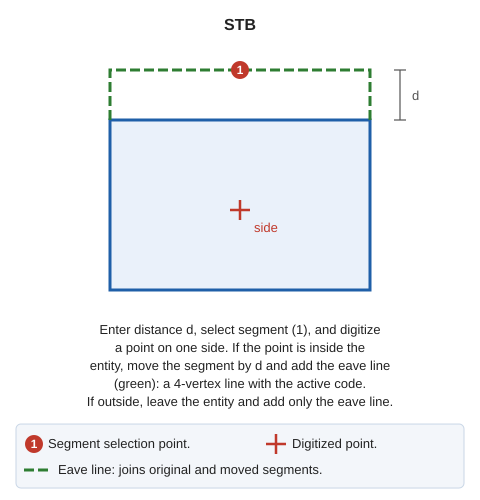

# STB
<!-- id: ret -->
<!-- origen: a2a5a0771b18d9ec0bbc633477864574a7723336 -->

Set back a segment of an entity.

## Parameters

Does not accept parameters.

## Notes

Procedure:

1. Enter the setback distance in the status bar or measure it by digitizing two points.
2. Select the segment to set back.
3. Digitize a point on the side toward which to move it. The moved segment's endpoints are intersections with the straight lines of adjacent segments.

If the point is inside the entity, move the segment and add the eave line: a 4-vertex line with the active code joining the original segment to the moved one. If the point is outside, leave the entity unchanged and add only the eave line.

To select the segment, use a search mode that snaps by projecting onto the segment rather than onto vertices.

## Command characteristics

| Command type | [Interactive command](/digi3d-ai/referencia/ordenes/ordenes-interactivas.md) |
| :--- | :--- |
| Repeats automatically | Yes |
| Menu option | Edit/Polylines/Offset a line |
| Toolbar | _This command has no associated toolbar button_ |
| Extension | DigiNG.OrdenesStandard.dll |
| Implementation | Native |
| Related variables | [REPEAT](/digi3d-ai/referencia/ventana-de-dibujo/variables/r/repite.md) — repeat the last command executed |
| Related commands | No related commands |
| Internal name | {0AF68209-0D11-480c-A85C-7F332089F1A6} |
