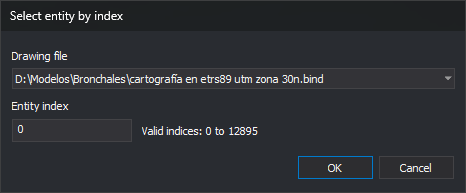

# SELECT\_INDEX
<!-- id: selecciona-indice -->
<!-- origen: fd3bd8f31d72b4cfec67538799bdc7a1a42a1336 -->

Send the entity at a specified position in a loaded drawing file to the running command.

## Parameters

| Parameter number | Description | Optional |
| :--- | :--- | :--- |
| 1 | Drawing file index. Its position in the loading order of the drawing file and reference files: 0 is the first loaded file, which need not be the active drawing file | Yes |
| 2 | Entity index within that file. The first entity is 0 | Yes |

Separate the parameters with a space, for example `SELECT_INDEX 0 125`. Supply both or neither. Each must be a nonnegative integer of up to 9 digits, without a sign or decimal places. Parameters after the second are ignored.

## Notes

The entity index is its position within the file, including deleted entities.

SELECT\_INDEX sends the entity to the running command, which remains active. If that command accepts single selection, it receives the entity as selected at its first vertex. Otherwise, it receives a data button press at the entity's first vertex. SELECT\_INDEX does not mark the entity as selected, center the view on it, or change zoom.

### Dialog box

Without parameters, for example from the menu option or toolbar button, the command displays _Select entity by index_:

| Field | Description | Default value |
| :--- | :--- | :--- |
| Drawing file | List of loaded drawing and reference files in index order | Active drawing file |
| Entity index | Entity position within the selected file, starting at 0. Accepts up to 9 digits | 0 |

The valid index range appears to the right of _Entity index_, for example _Valid indices: 0 to 7528_. If the file has no entities, _The selected drawing file has no entities._ appears. This text updates when another file is selected.

Values are not saved: each opening shows the active drawing file and index 0.

Click _OK_ to check both values:

* If the selected file has no entities, display _The selected drawing file has no entities._ and move the cursor to the list.
* If the index is empty, is not a nonnegative integer, or is out of range, display _The entity index must be an integer between 0 and N._, where N is the last valid index, and select the field's contents.

If the selected file has no entities or the entity index is invalid, the dialog box stays open. If both values are valid, close it and send the entity as if both values had been supplied as parameters.

Click _Cancel_ to end without sending anything.

### Errors

Sound the error tone and send nothing in these cases:

* No command is running. The dialog box is not displayed either.
* The running command ends while the dialog box is open.
* Only one parameter is supplied, or either is not a nonnegative integer of up to 9 digits.
* The file or entity index is out of range.
* The entity is deleted and [DELETED](/digi3d-ai/referencia/ventana-de-dibujo/variables/b/borrados.md) is disabled.
* The entity is invisible because it is hidden or all its codes are disabled in the drawing window.
* The entity is outside the area of interest.
* The entity has no vertices.

## Command characteristics

| Command type | Immediate command |
| :--- | :--- |
| Repeats automatically | No |
| Menu option | Immediate/Select entity based on position in file... |
| Toolbar | Selections |
| Extension | DigiNG.OrdenesStandard.dll |
| Implementation | Native |
| Related variables | [DELETED](/digi3d-ai/referencia/ventana-de-dibujo/variables/b/borrados.md) |
| Related commands | [SELECT\_LAST](/digi3d-ai/referencia/ventana-de-dibujo/ordenes/s/selecciona-ultimo.md) |
| Internal name | {C735FB18-183F-4884-A85D-F08521DC40BC} |
