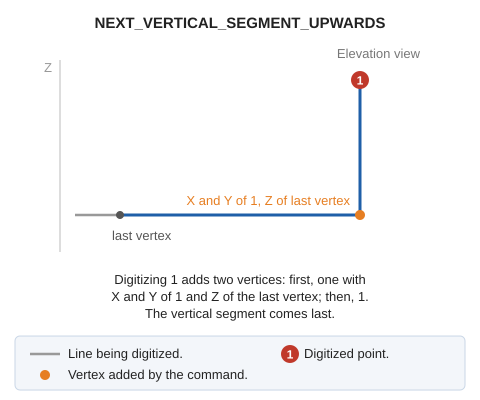

# NEXT\_VERTICAL\_SEGMENT\_UPWARDS
<!-- id: siguiente-segmento-vertical-hacia-arriba -->
<!-- origen: 95a99817b37c239a346e2966c8a048178d851703 -->

Configure the active command so that the next segment inserted is vertical and consists of two points.

## Parameters

Does not accept parameters.

## Notes

Run the command while digitizing a line with at least one vertex. Digitizing the next point adds two vertices:

1. One with the X and Y coordinates of the digitized point and the Z of the last vertex.
2. The digitized point. The segment leading to it is vertical.

Compare this with [NEXT\_VERTICAL\_SEGMENT\_DOWNWARDS](/digi3d-ai/referencia/ventana-de-dibujo/ordenes/s/siguiente-segmento-vertical-hacia-abajo.md), which places the vertical segment first.

## Command characteristics

| Command type | [Interactive command](/digi3d-ai/referencia/ordenes/ordenes-interactivas.md) |
| :--- | :--- |
| Repeats automatically | No |
| Menu option | _This command has no associated menu option_ |
| Toolbar | _This command has no associated toolbar button_ |
| Extension | DigiNG.OrdenesStandard.dll |
| Implementation | Native |
| Related variables | No related variables |
| Related commands | [NEXT\_VERTICAL\_SEGMENT\_DOWNWARDS](/digi3d-ai/referencia/ventana-de-dibujo/ordenes/s/siguiente-segmento-vertical-hacia-abajo.md) |
| Internal name | {6E8ABC67-F614-475B-844E-9762CAFCFBF0} |
