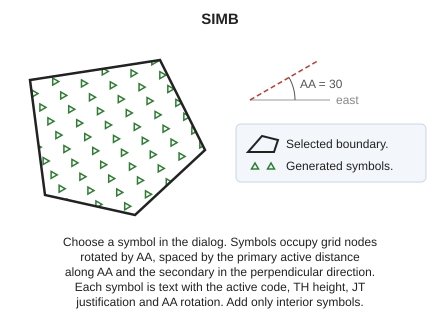
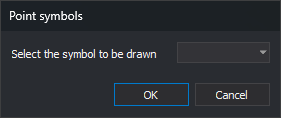

# SIMB
<!-- id: simb -->
<!-- origen: 10a3ecde49a833e0968092189d442a298e04e237 -->

Fill the interior of a closed area entity with a pattern of symbols.

## Parameters

| Parameter number | Description | Optional |
| :--- | :--- | :--- |
| 1 | One or more codes, separated by spaces | Yes |

Without parameters, the command asks you to select the line to fill. With codes, it fills all visible closed lines with those codes and ends.

## Point symbols dialog

When the command starts, before processing parameters, the **Point symbols** dialog appears:

**Select the symbol to be drawn** lists symbols loaded with the code table. Only symbols whose names are not numbers are listed: numeric names represent font characters. Initially, the last accepted symbol is selected, or the first listed symbol if that symbol is no longer in the code table.

* **OK** continues with the selected symbol. If the code table contains no symbols, the list is empty and **OK** ends the command, like **Cancel**.
* **Cancel** ends the command without adding anything.

## Notes

Without parameters, the command displays "Select the line to be pointed with symbols". Press the data or tentative button on the line to fill. Selecting an entity other than a line plays the error sound and leaves the command waiting. After filling the line, it beeps and ends. It does not check whether the selected line is closed.

Symbols occupy the same points as [POINT_WEAVE](/digi3d-ai/referencia/ventana-de-dibujo/ordenes/p/puntear.md), at the intersections of stripes that [WEAVE](/digi3d-ai/referencia/ventana-de-dibujo/ordenes/t/tramar.md) would generate:

* Along the [active angle](/digi3d-ai/referencia/ventana-de-dibujo/variables/a/aa.md), symbols are spaced by the primary active distance.
* In the perpendicular direction, they are spaced by the secondary active distance.

Set both distances with [AD](/digi3d-ai/referencia/ventana-de-dibujo/variables/d/da.md).

Each symbol is added as text containing `@` followed by the symbol name, with the active code and Z = 0. The text uses [TH](/digi3d-ai/referencia/ventana-de-dibujo/variables/a/at.md) height, [JT](/digi3d-ai/referencia/ventana-de-dibujo/variables/j/jt.md) justification, and active angle rotation. Only text entirely inside the boundary is added.

The symbol is drawn only if the active code uses a Digi font. With a TrueType font, the literal text `@nombre` is written.

## Command characteristics

| Command type | [Interactive command](/digi3d-ai/referencia/ordenes/ordenes-interactivas.md) |
| :--- | :--- |
| Repeats automatically | No |
| Menu option | Draw/More/Fill polygon with symbols |
| Toolbar | _This command has no associated toolbar button_ |
| Extension | DigiNG.OrdenesStandard.dll |
| Implementation | Native |
| Related variables | [AA](/digi3d-ai/referencia/ventana-de-dibujo/variables/a/aa.md) — active angle [TH](/digi3d-ai/referencia/ventana-de-dibujo/variables/a/at.md) — text height [AD](/digi3d-ai/referencia/ventana-de-dibujo/variables/d/da.md) — active distance [JT](/digi3d-ai/referencia/ventana-de-dibujo/variables/j/jt.md) — text justification |
| Related commands | [DIVIDE](/digi3d-ai/referencia/ventana-de-dibujo/ordenes/d/dividir.md) [POINT_WEAVE](/digi3d-ai/referencia/ventana-de-dibujo/ordenes/p/puntear.md) [SCRATCH](/digi3d-ai/referencia/ventana-de-dibujo/ordenes/r/rayar.md) [WEAVE](/digi3d-ai/referencia/ventana-de-dibujo/ordenes/t/tramar.md) |
| Internal name | {8C69C4FD-E23F-4c34-A90E-EEC98079CD61} |
