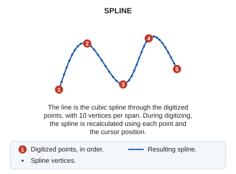

# SPLINE
<!-- id: spline -->
<!-- origen: 5fd3f96b821bd48ada8603dfda0d968233ce0523 -->

Draw a shape using arcs and convert them into a smooth curve.

## Parameters

Does not accept parameters.

## Notes

Define the points through which the SPLINE curve will pass. As you digitize points, cursor movement modifies the vertices determining the curve's shape.

The _SPLINES_ generated in DIGI are CUBIC SPLINES.

## Command characteristics

| Command type | [Interactive command](/digi3d-ai/referencia/ordenes/ordenes-interactivas.md) |
| :--- | :--- |
| Repeats automatically | Yes |
| Menu option | Draw/Spline |
| Toolbar | Polylines |
| Extension | DigiNG.OrdenesStandard.dll |
| Implementation | Native |
| Related variables | [REPEAT](/digi3d-ai/referencia/ventana-de-dibujo/variables/r/repite.md) — repeat the last command executed |
| Related commands | [CLOSE\_ENT](/digi3d-ai/referencia/ventana-de-dibujo/ordenes/c/cierra-ent.md) [LINE](/digi3d-ai/referencia/ventana-de-dibujo/ordenes/l/linea.md) [SMOOTH\_SPLINE](/digi3d-ai/referencia/ventana-de-dibujo/ordenes/s/suaviza-spline.md) |
| Internal name | {A585D55F-20B4-41a7-AC7E-4B0E8A9C32AA} |
