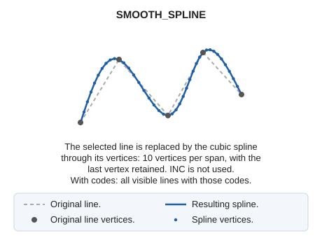

# SMOOTH\_SPLINE
<!-- id: suaviza-spline -->
<!-- origen: c49acc8588d0a77174fdbc9a96d97cd8edafc5f0 -->

Smooth a line by creating a cubic spline.

## Parameters

| Parameter number | Description | Optional |
| :--- | :--- | :--- |
| 1 … N | Code or codes of the entities to smooth | Yes |

## Notes

Specify the code as a SMOOTH\_SPLINE parameter to smooth all entities with that code:

`SMOOTH_SPLINE=020200`

With codes, the command replaces all visible lines with those codes by their splines, then ends. Without parameters, it prompts you to select the line (or multiple lines).

The result is a cubic spline through the original line's vertices: each span is replaced by 10 vertices, and the last vertex is retained. Unlike [SMOOTH](/digi3d-ai/referencia/ventana-de-dibujo/ordenes/s/suaviza.md), the spacing of new vertices does not depend on the recording increment INC.

If quality control rejects the modified entity, the original entity is preserved unchanged. With multiple entities, each is handled independently: the original is preserved only for rejected entities, and the others are smoothed.

## Command characteristics

| Command type | [Interactive command](/digi3d-ai/referencia/ordenes/ordenes-interactivas.md) |
| :--- | :--- |
| Repeats automatically | Yes |
| Menu option | _This command has no associated menu option_ |
| Toolbar | _This command has no associated toolbar button_ |
| Extension | DigiNG.OrdenesStandard.dll |
| Implementation | Native |
| Related variables | [REPEAT](/digi3d-ai/referencia/ventana-de-dibujo/variables/r/repite.md) — repeat the last command executed |
| Related commands | [SPLINE](/digi3d-ai/referencia/ventana-de-dibujo/ordenes/s/spline.md) [SMOOTH](/digi3d-ai/referencia/ventana-de-dibujo/ordenes/s/suaviza.md) |
| Internal name | {78596F76-80D8-43E2-894C-08B07686BCD5} |
