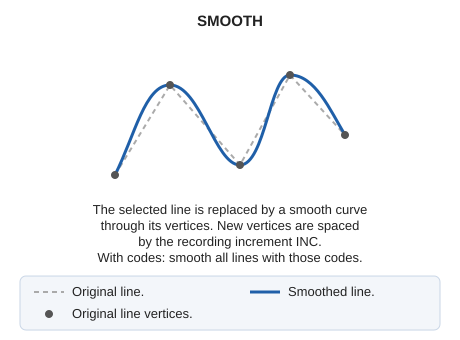

# SMOOTH
<!-- id: suaviza -->
<!-- origen: 226550a6dedcec6832079b95810f933e67aa5f1f -->

Smooth the geometric shape of an existing linear element in the drawing.

## Parameters

| Parameter number | Description | Optional |
| :--- | :--- | :--- |
| 1 … N | Code or codes of the entities to smooth | Yes |

## Notes

Specify the code as a SMOOTH parameter to smooth all entities with that code:

`SMOOTH=020200`

The command requires the element to be specified graphically. When you run the command, the program prompts you to select the entity.

The command adds points to the entity to generate a smooth line.

New points are spaced by a distance equal to [INC](/digi3d-ai/referencia/ventana-de-dibujo/variables/i/inc.md).

If quality control rejects the modified entity, the original entity is preserved unchanged. With multiple entities, each is handled independently: the original is preserved only for rejected entities, and the others are smoothed.

## Command characteristics

| Command type | [Interactive command](/digi3d-ai/referencia/ordenes/ordenes-interactivas.md) |
| :--- | :--- |
| Repeats automatically | Yes |
| Menu option | Edit/Polylines/Smooth |
| Toolbar | Edit polyline |
| Extension | DigiNG.OrdenesStandard.dll |
| Implementation | Native |
| Related variables | [INC](/digi3d-ai/referencia/ventana-de-dibujo/variables/i/inc.md) — active recording increment [REPEAT](/digi3d-ai/referencia/ventana-de-dibujo/variables/r/repite.md) — repeat the last command executed |
| Related commands | [SMOOTH\_SPLINE](/digi3d-ai/referencia/ventana-de-dibujo/ordenes/s/suaviza-spline.md) |
| Internal name | {D65F1A76-8D76-43fa-9ACC-809CFE01E035} |
