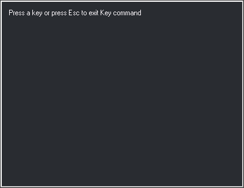
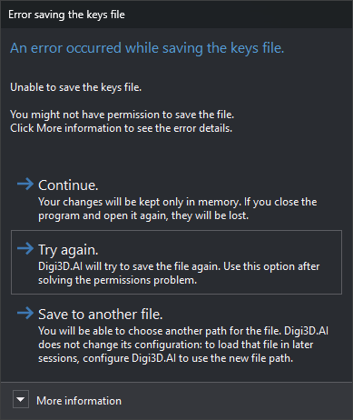

# KEY
<!-- id: tecla -->
<!-- origen: 7f0c1746f146f68ac598ea9dd19a90bf1690ca66 -->

Assign Digi3D.AI commands to keystrokes in the active virtual keyboard.

## Parameters

| Parameter number | Description | Values | Optional |
| :--- | :--- | :--- | :--- |
| 1 | Text file containing commands to assign, one per line | File path | Yes |

## Notes

Create or modify assignments in the active virtual keyboard (`.keyboard.xml`) without editing the file manually.

1. The command opens **Press a key or press Esc to exit Key command**:

   
2. Press the key or combination to assign, for example **Ctrl+a** or **Shift+F3**. **Shift**, **Ctrl**, **Alt**, **Pause**, and **Caps Lock** cannot be assigned alone, and **Esc** cannot be assigned. **F1** can: while this dialog waits for a key, it does not open help (see [Assigning F1](#assigning-f1)).
3. **Key assignment** opens:

   

   * **Key**: read-only name of the pressed key.
   * **Control**, **Shift**, and **Alt**: indicate modifiers pressed with the key. Disabled because the keystroke sets the combination. To assign another combination, click **Cancel** and press it.
   * **Description of the action taken when pressing this key**: description of what the key does.
   * **Enter the commands to be run when pressing this key**: commands to run, one per line.

   If already assigned, the existing commands and description appear.
4. Click **OK**. The assignment replaces the previous one and is immediately saved in the active virtual keyboard `.keyboard.xml` file. The command waits for another key.
5. Press **Esc** to finish.

**Cancel** in the assignment dialog retains the previous assignment and returns to waiting for another key.

To remove an assignment, clear all its commands and click **OK**.

The saved key name depends on the Windows keyboard layout language.

### Assigning F1

An **F1** assignment applies only when the drawing or photogrammetric window has focus. In dialogs, including **Key assignment**, **F1** still opens help.

With no assignment, **F1** in the drawing window runs [HELP](/digi3d-ai/referencia/ventana-de-dibujo/ordenes/a/ayuda.md), opening the current command help or the help home page. In the photogrammetric window, it opens the help home page.

### No virtual keyboard loaded

On **OK**, Digi3D.AI asks whether to create a key assignment file and requests its name. Answering **No** or canceling file selection leaves the assignment unsaved.

### File cannot be saved

If `.keyboard.xml` cannot be written (for example, due to permissions), **Error saving the keys file** appears:

**More information** shows the file path and operating system error. The dialog has no close button.

* **Continue.**: retain the assignment only in memory, losing it when the application closes.
* **Try again.** (or **Esc**): retry saving; another failure displays the dialog again.
* **Save to another file.**: request another path and save the entire virtual keyboard there. Until Digi3D.AI closes, subsequent assignments use that new file. Configuration is unchanged: to load it in later sessions, add it to [Virtual keyboard configuration](../../../cuadros-de-dialogo/configuracion-de-teclados-virtuales.md) or, with projects enabled, **Keyboard** in [project configuration](../../../cuadros-de-dialogo/configurar-proyectos.md). Canceling path selection retries the original file.

### With a parameter

The assignment dialog shows commands read from the file instead of the existing assignment, with an empty description. The command ends after **OK** or **Cancel**. Files use Windows ANSI encoding. If the file cannot be opened, behavior is the same as without a parameter.

Digi3D.AI uses this mode to assign a recorded macroinstruction to a key.

### No drawing window open

**Photogrammetric window/Keyboard/Key programmer** runs this command when a drawing window is open. With only photogrammetric windows, it runs the version in _Digi3D.CommonCommands.dll_ (internal name {4726C0C5-1522-4c56-A439-0D644E6D1BFE}). That version uses the same dialogs and virtual keyboard, with two differences:

* It accepts no parameter: it has no command name and runs only from that menu option.
* **Key assignment** cannot be resized and does not save its position.

In the photogrammetric window, **Enter** always opens the [command entry field](/digi3d-ai/referencia/ordenes/formas-de-ejecutar-una-orden/ejecutar-una-orden-desde-la-linea-de-comandos/README.md#in-the-photogrammetric-window) in the message bar, even when commands are assigned to it.

## Command characteristics

| Command type | Immediate command |
| :--- | :--- |
| Repeats automatically | No |
| Menu option | Immediate/Virtual keyboards/Assign a command to an active virtual keyboard... Photogrammetric window/Keyboard/Key programmer |
| Toolbar | Keyboards |
| Extension | DigiNG.OrdenesStandard.dll (Digi3D.CommonCommands.dll when no drawing windows are open) |
| Implementation | Native |
| Related variables | No related variables |
| Related commands | [CHANGE\_KEYS\_MNU](/digi3d-ai/referencia/ventana-de-dibujo/ordenes/c/cambia-teclas-mnu.md) |
| Internal name | {EB6809CA-AA03-4dfb-9D7A-D639EFDBC051} |

## Note

Digi3D.AI cannot import key files from earlier versions. Use the [console program](/digi3d-ai/primeros-pasos/primeros-pasos-usuarios-versiones-anteriores/archivos-configuracion-teclas.md) to import them.
