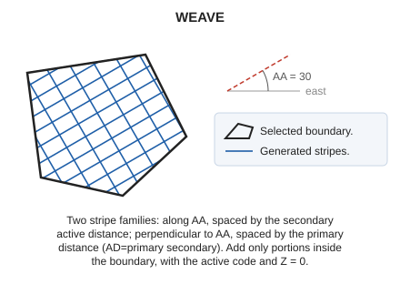

# WEAVE
<!-- id: tramar -->
<!-- origen: ef954895c9c94afa455000383c784d084239c827 -->

Crosshatch the interior of a closed area entity.

## Parameters

| Parameter number | Description | Optional |
| :--- | :--- | :--- |
| 1 | Code or codes (one or more, separated by spaces) | Yes |

Without parameters, select the closed line to crosshatch. With codes, crosshatch all visible closed lines bearing them and end.

## Notes

The pattern has two stripe families determined by the [active angle](/digi3d-ai/referencia/ventana-de-dibujo/variables/a/aa.md) and both active distances set with [AD](/digi3d-ai/referencia/ventana-de-dibujo/variables/d/da.md):

* First-family stripes are perpendicular to the active angle and spaced by the primary active distance.
* Second-family stripes follow the active angle and are spaced by the secondary active distance, as generated by [SCRATCH](/digi3d-ai/referencia/ventana-de-dibujo/ordenes/r/rayar.md).

Add only stripe portions inside the boundary, with the active code and Z = 0.

## Command characteristics

| Command type | [Interactive command](/digi3d-ai/referencia/ordenes/ordenes-interactivas.md) |
| :--- | :--- |
| Repeats automatically | No |
| Menu option | Draw/More/Fill polygon with a section |
| Toolbar | _This command has no associated toolbar button_ |
| Extension | DigiNG.OrdenesStandard.dll |
| Implementation | Native |
| Related variables | [AA](/digi3d-ai/referencia/ventana-de-dibujo/variables/a/aa.md) — active angle [AD](/digi3d-ai/referencia/ventana-de-dibujo/variables/d/da.md) — active distance [REPEAT](/digi3d-ai/referencia/ventana-de-dibujo/variables/r/repite.md) — repeat the last command executed |
| Related commands | [POINT_WEAVE](/digi3d-ai/referencia/ventana-de-dibujo/ordenes/p/puntear.md) [SCRATCH](/digi3d-ai/referencia/ventana-de-dibujo/ordenes/r/rayar.md) [SIMB](/digi3d-ai/referencia/ventana-de-dibujo/ordenes/s/simb.md) |
| Internal name | {D5791ADD-DD21-4523-9A26-04F3AAAA2D4F} |
