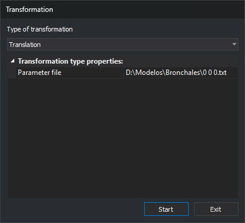

# TRANSFORM
<!-- id: transforma -->
<!-- origen: be0920d6ee1bc8d8145eb7129805687d3161215d -->

Apply a coordinate transformation to entities in the active drawing file: Helmert, affine, absolute, translation, scale, or a 3×3 or 4×4 matrix.

## Parameters

Without parameters, the command displays the _Transformation_ dialog box. With parameters, it applies the transformation without displaying the dialog box. There are two forms:

`TRANSFORM=[tipo] [archivo]`

* **type**: `HELMERT`, `AFIN`, `ABSOLUTA`, `TRASLACION`, `TENSOR3X3`, or `TENSOR4X4`, case-insensitive. These are the types in the dialog box drop-down list, except scale.
* **file**: the point or matrix file required by that type in the dialog box. Enclose paths containing spaces in quotation marks.

`TRANSFORM=ESCALA [factor X] [factor Y] [factor Z] [escalar la altura de los textos]`

* **X factor**, **Y factor**, and **Z factor**: real numbers with a decimal point.
* **scale text height**: `1` scales text height; `0` preserves it.

If the parameters do not match either form, the command displays an error message and finishes without transforming anything.

Examples:

`TRANSFORM=HELMERT "C:\puntos.txt"`

`TRANSFORM=ESCALA 2 2 1 0`

When recording a macro, the command records the type and values chosen in the dialog box as parameters. If you cancel the dialog box, the command does not record the parameters.

## Notes

### Dialog box



Running the command displays the _Transformation_ dialog box:

| Field | Description |
| :--- | :--- |
| Type of transformation | Helmert, Affine, Absolute, Translation, Scale, 3x3 tensor, or 4x4 tensor. See [Transformation types](#transformation-types) |
| Transformation type properties | Data for the selected type. Scale displays four fields; the other types display the _Parameter file_ field |

| Property | Types | Description | Default value |
| :--- | :--- | :--- | :--- |
| Parameter file | All except Scale | Text file with the transformation data. The button on the right opens the file selection dialog box. Each type remembers its own file | _Empty_ |
| X Factor | Scale | Factor by which the X coordinate is multiplied | 1 |
| Y Factor | Scale | Factor by which the Y coordinate is multiplied | 1 |
| Z Factor | Scale | Factor by which the Z coordinate is multiplied | 1 |
| Text height | Scale | _Yes_ multiplies text height by the absolute value of the X factor. _No_ preserves the height | Yes |

When the dialog box opens, the _Start_ button has focus.

Clicking _Start_ saves the transformation type and its properties in the registry key `HKEY_CURRENT_USER\Software\Digi21\Digi3D.NET\DigiNG\Extensiones\DigiNG.OrdenesStandard\Bintrans`, in the values `TipoTransformacion`, `ArchivoHelmert`, `ArchivoAfin`, `ArchivoAbsoluta`, `ArchivoTraslacion`, `ArchivoTransformacion3x3`, `ArchivoTransformacion4x4`, `FactorX`, `FactorY`, `FactorZ`, and `EscaladoAlturaTextos`. The command then reads the parameter file and applies the transformation. If the file is invalid, it displays a message, leaves the drawing file unchanged, and keeps the dialog box open. If the transformation finishes, the dialog box closes. The next time you run the command, the dialog box displays the saved values.

Click _Exit_ to close the dialog box without saving the values or transforming anything.

### Transformation types

In the formulas, (x, y, z) are the original coordinates and (X, Y, Z) are the transformed coordinates.

| Type | Transformation | Z | Required points |
| :--- | :--- | :--- | :--- |
| Helmert | Planar similarity: X = a·x + b·y + Tx, Y = −b·x + a·y + Ty. Calculates a, b, Tx, and Ty using least squares | Unchanged | 2 or more |
| Affine | X = a·x + b·y + c, Y = d·x + e·y + f. Calculates the 6 coefficients using least squares | Unchanged | 3 or more, not collinear |
| Absolute | Spatial similarity: one scale factor, three rotations, and a translation, calculated using least squares | Changes | Between 3 and 1000, not collinear |
| Translation | X = x + (X1 − x1), Y = y + (Y1 − y1), Z = z + (Z1 − z1) | Changes | 1 |
| Scale | X = X Factor · x, Y = Y Factor · y, Z = Z Factor · z. The scaling center is the coordinate origin (0, 0, 0) | Changes | None |
| 3x3 tensor | X = a00·x + a10·y + a20·z, Y = a01·x + a11·y + a21·z, Z = a02·x + a12·y + a22·z | Changes | None |
| 4x4 tensor | Same as the 3x3 tensor, plus translation (a30, a31, a32). The command does not use the fourth column (a03, a13, a23, a33) | Changes | None |

For Helmert and affine transformations, source points must be distinct, and target points must also be distinct. For affine and absolute transformations, the points must also not all lie on a straight line: at least one point must be farther from the line joining the two farthest points than one thousandth of the distance between those two points.

### Parameter file

The parameter file is a text file. Each line contains numbers separated by spaces, tabs, or commas. Use a decimal point regardless of the Windows regional settings. The command accepts scientific notation (`1.5e3`) and UTF-8 files with a BOM.

| Type | Contents of each line | Lines read |
| :--- | :--- | :--- |
| Helmert, Affine | x y X Y: coordinates of a point in the original and target systems | All |
| Absolute | x y z X Y Z | All, up to 1000 |
| Translation | x1 y1 z1 X1 Y1 Z1 | First line with 6 numbers |
| 3x3 tensor | One matrix row: a_i0 a_i1 a_i2 | First 3 lines with 3 numbers |
| 4x4 tensor | One matrix row: a_i0 a_i1 a_i2 a_i3 | First 4 lines with 4 numbers |

The command ignores empty lines, lines with fewer numbers than required, and items after the required ones, such as a fifth column containing the point name in a Helmert file. If a line has enough items but a required item is not a number (for example, the header `X Y X' Y'`), the command displays a message with that line number and does not transform anything.

File for Helmert or affine transformations:

```
450000.00 4500000.00 450012.35 4500105.20
451000.00 4500000.00 451012.80 4500104.95
451000.00 4501000.00 451012.55 4501105.40
```

File for translation:

```
0 0 0 1000 2000 0
```

File for a 4x4 tensor, with a 90° rotation and a translation of (100, 200, 0):

```
0 1 0 0
-1 0 0 0
0 0 1 0
100 200 0 1
```

The command displays a message, does not transform anything, and leaves the dialog box open in these cases:

* The file does not exist, cannot be opened, or the field is empty.
* A line contains a value that is not a number.
* The file does not have enough lines with numbers. The message specifies the number of lines required by the selected type and the number of numbers required per line.
* The absolute transformation has more than 1000 points.
* The points are repeated or collinear and do not define the transformation.

### Entities transformed

The command transforms entities in the active drawing file that are not deleted, are visible, and are within the area of interest. It does not transform other loaded drawing files. Each entity is deleted and replaced with a transformed copy added at the end of the file.

* All vertices are transformed, including polygon hole vertices and the vertices of each entity in complex entities.
* The transformation changes the XY rotation direction of text, point symbols, and point-based complex entities. If the transformation reflects the drawing, text follows the reflected direction, but the characters are not mirrored.
* Text height changes only with scale, when _Text height_ is _Yes_. Other types preserve it, even if the transformation includes a scale factor.
* Point symbol sizes do not change.

When finished, the command recalculates the drawing file extents. [UNDO](/digi3d-ai/referencia/ventana-de-dibujo/ordenes/u/undo.md) undoes the entire transformation in a single operation.

If Digi3D.AI rejects any transformed entity, the command does not apply the transformation and preserves the original entities.

## Command characteristics

| Command type | Immediate command |
| :--- | :--- |
| Repeats automatically | No |
| Menu option | Edit/Advanced/Transform the drawing file (Helmert, affine, absolute, translation, scale, tensor)... |
| Toolbar | _This command has no associated toolbar button_ |
| Extension | DigiNG.OrdenesStandard.dll |
| Implementation | Native |
| Related variables | No related variables |
| Related commands | [UNDO](/digi3d-ai/referencia/ventana-de-dibujo/ordenes/u/undo.md) |
| Internal name | {0D75B4EC-3036-4684-95A4-D2119B3A6E88} |
