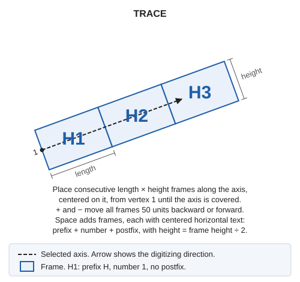
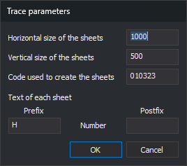

# TRACE
<!-- id: traza -->
<!-- origen: 966dfcbd914b3e548bb0dc66aae45c76dfc77bae -->

Create a sheet index along an axis line: consecutive frames, with sheet name text at the center of each. [TRIM\_TRACE](/digi3d-ai/referencia/ventana-de-dibujo/ordenes/r/recorta-traza.md) then creates a file for each frame.

## Parameters

This command takes no parameters.

## Notes

### Dialog

The **Trace parameters** dialog requests:

| Field | Description | Default value |
| :--- | :--- | :--- |
| Horizontal size of the sheets | Frame length along the axis, in drawing coordinate units. Must be greater than 0 | 700 |
| Vertical size of the sheets | Frame height perpendicular to the axis, in drawing coordinate units. The frame is centered on the axis. Must be greater than 0 | 500 |
| Code used to create the sheets | Frame and text code. Used even if absent from the code table | HOJAS |
| Prefix | Text before the sheet number. May be empty | H |
| Postfix | Text after the sheet number. May be empty | Empty |

**Prefix**, **Number**, and **Postfix** in **Text of each sheet** show the sheet name order. **Number** is not an input field: the command assigns it.

**OK** validates both sizes. If either is not a finite number greater than 0, a message appears, focus moves to that field, and the dialog stays open without saving. Valid values are saved as `TamanoHorizontal`, `TamanoVertical`, `Codigo`, `Prefijo`, and `Postfijo` under registry key `HKEY_CURRENT_USER\Software\Digi21\Digi3D.NET\DigiNG\Extensiones\DigiNG.OrdenesStandard\Traza`. They appear on the next run.

**Cancel** ends without saving values.

### Selecting the axis

After the dialog, the command line displays **Select the line used as the trace axis...**. Select the axis with the data or tentative pedal. The command runs [SNAP](/digi3d-ai/referencia/barras-de-herramientas/tentativo.md) with `L*@`, selecting only active drawing file lines. An entity that is not a line or has fewer than two vertices plays the error sound, leaving the command waiting for a line.

After axis selection, temporary frames appear:

* The first begins at the first axis vertex, following the first segment direction.
* Each begins where the previous ends, measured along the axis, until the entire axis is covered. The last may extend beyond the final vertex.
* Each follows the direction of the axis segment where it starts. If it crosses an axis vertex, its last two corners are moved to the first two of the next frame, joining the frames without gaps or overlap. That frame is no longer rectangular.

Selecting another line removes the temporary frames and recalculates them along the new axis.

### Adjusting and creating sheets

With an axis selected, the command line displays **[+] Move the sheets backwards [-] Move the sheets forwards [Space] Create the sheets**:

* **+** moves all frames 50 units backward, against the axis digitizing direction. The first then begins before the first vertex.
* **−** moves all frames 50 units forward. The first then begins after the first vertex, leaving the axis start uncovered.
* **Space** adds frames and text to the active drawing file and ends the command.

**+** and **−** work on the main keyboard and numeric keypad. Selecting an axis resets the offset to 0.

Each frame is a closed five-vertex line (four corners and closure). Each text entity:

* Uses the frame code.
* Is centered at the frame diagonal intersection, the center for rectangular frames.
* Is horizontal, without rotation, regardless of axis direction.
* Has a height equal to half the vertical size.
* Contains prefix, sheet number, and postfix without separators. Numbers start at 1 and increase along the axis without leading zeros: prefix `H` with no postfix gives `H1`, `H2`, `H3`...

Frames and text have Z = 0 regardless of axis Z. The axis line is unchanged.

Until **Space** is pressed, frames are temporary. Ending another way, for example by running another command, removes them and adds nothing. Pressing **Space** before selecting an axis ends without adding anything.

[UNDO](/digi3d-ai/referencia/ventana-de-dibujo/ordenes/u/undo.md) removes all added frames and text in one operation.

### Creating sheet files

TRACE creates no files. To create a file per sheet, run [TRIM\_TRACE](/digi3d-ai/referencia/ventana-de-dibujo/ordenes/r/recorta-traza.md) afterward with the same frame code; it uses each frame text as the filename.

## Command characteristics

| Command type | [Interactive command](/digi3d-ai/referencia/ordenes/ordenes-interactivas.md) |
| :--- | :--- |
| Repeats automatically | No |
| Menu option | Draw/Sheet index/Create sheet index (trace) |
| Toolbar | _This command has no associated toolbar button_ |
| Extension | DigiNG.OrdenesStandard.dll |
| Implementation | Native |
| Related variables | No related variables |
| Related commands | [SHEET](/digi3d-ai/referencia/ventana-de-dibujo/ordenes/h/hoja.md) [TRIM\_TRACE](/digi3d-ai/referencia/ventana-de-dibujo/ordenes/r/recorta-traza.md) [UNDO](/digi3d-ai/referencia/ventana-de-dibujo/ordenes/u/undo.md) |
| Internal name | {C1531BAF-268D-4b68-A830-884AF84BF21F} |
