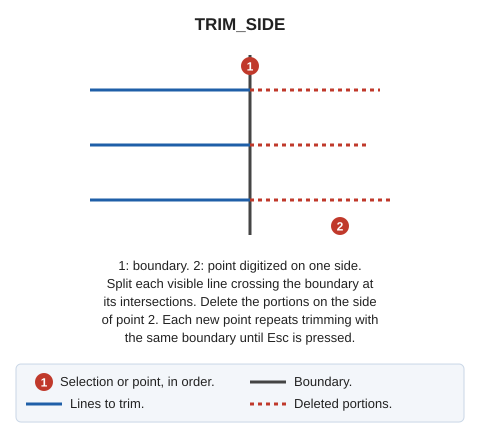

# TRIM\_SIDE
<!-- id: trim-lado -->
<!-- origen: 90788c2333d971339aa846efb2e64f9d74425580 -->

Trim multiple entities by first selecting the boundary line and then digitizing a point on one side.

## Parameters

Does not accept parameters.

## Notes

Trim all entities on the side indicated by the digitized point.

If Digi3D.AI rejects any new portion, no entities are trimmed and all originals are retained.

## Command characteristics

| Command type | [Interactive command](/digi3d-ai/referencia/ordenes/ordenes-interactivas.md) |
| :--- | :--- |
| Repeats automatically | Yes |
| Menu option | Edit/Polylines/Cut multiple lines where they cross another line (on one side) |
| Toolbar | Extend/Cut |
| Extension | DigiNG.OrdenesStandard.dll |
| Implementation | Native |
| Related variables | [REPEAT](/digi3d-ai/referencia/ventana-de-dibujo/variables/r/repite.md) — repeat the last command executed |
| Related commands | [TRIM](/digi3d-ai/referencia/ventana-de-dibujo/ordenes/t/trim.md) [TRIM\_M](/digi3d-ai/referencia/ventana-de-dibujo/ordenes/t/trim-m.md) |
| Internal name | {D2EF5B75-4075-450B-9A06-00A941807D71} |
