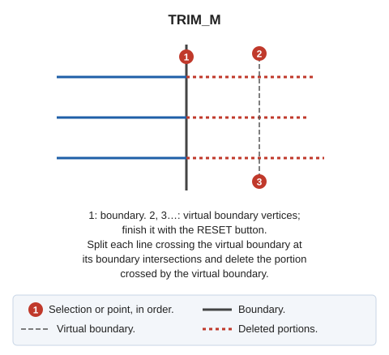

# TRIM\_M
<!-- id: trim-m -->
<!-- origen: 030bf7e723e3208bbc6673690f7706260442be5c -->

Trim multiple entities by first selecting the boundary line and then digitizing a virtual boundary.

## Parameters

Does not accept parameters.

## Notes

Trim all entities intersecting the virtual boundary.

If Digi3D.AI rejects any new portion of an entity, that entity is not trimmed and its original is retained. With multiple entities, each is handled independently: only the original of each rejected entity is retained, and the others are trimmed.

## Command characteristics

| Command type | [Interactive command](/digi3d-ai/referencia/ordenes/ordenes-interactivas.md) |
| :--- | :--- |
| Repeats automatically | Yes |
| Menu option | Edit/Polylines/Cut multiple lines where they cross another line |
| Toolbar | Extend/Cut |
| Extension | DigiNG.OrdenesStandard.dll |
| Implementation | Native |
| Related variables | [REPEAT](/digi3d-ai/referencia/ventana-de-dibujo/variables/r/repite.md) — repeat the last command executed |
| Related commands | [SPR\_M](/digi3d-ai/referencia/ventana-de-dibujo/ordenes/e/ext-m.md) [TRIM](/digi3d-ai/referencia/ventana-de-dibujo/ordenes/t/trim.md) [TRIM\_SIDE](/digi3d-ai/referencia/ventana-de-dibujo/ordenes/t/trim-lado.md) |
| Internal name | {729B6BE7-084A-4F15-802C-F649D5348563} |
