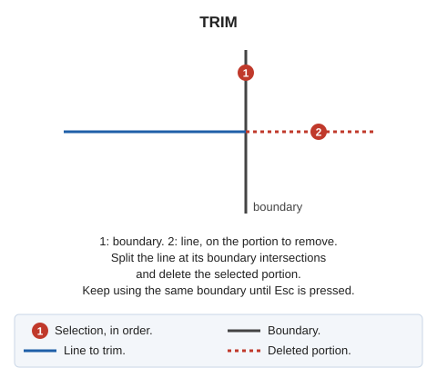

# TRIM
<!-- id: trim -->
<!-- origen: f13cf0a124c1e5ef6d1a24a7e2b516b9b67a254a -->

Trim an entity to its intersection with another entity's boundary.

## Parameters

Does not accept parameters.

If Digi3D.AI rejects any new portion, the entity is not trimmed and the original is retained.

## Command characteristics

| Command type | [Interactive command](/digi3d-ai/referencia/ordenes/ordenes-interactivas.md) |
| :--- | :--- |
| Repeats automatically | Yes |
| Menu option | Edit/Polylines/Cut a line where it crosses another line |
| Toolbar | Extend/Cut |
| Extension | DigiNG.OrdenesStandard.dll |
| Implementation | Native |
| Related variables | [REPEAT](/digi3d-ai/referencia/ventana-de-dibujo/variables/r/repite.md) — repeat the last command executed |
| Related commands | [EXTEND\_TRIM\_BY\_TOLERANCE](/digi3d-ai/referencia/ventana-de-dibujo/ordenes/e/estira-recorta-por-tolerancia.md) [SPR](/digi3d-ai/referencia/ventana-de-dibujo/ordenes/e/ext.md) [TRIM\_SIDE](/digi3d-ai/referencia/ventana-de-dibujo/ordenes/t/trim-lado.md) [TRIM\_M](/digi3d-ai/referencia/ventana-de-dibujo/ordenes/t/trim-m.md) |
| Internal name | {5E8BD236-94A0-4b3e-BCB4-461DEE1D52B0} |

## Video

See also
