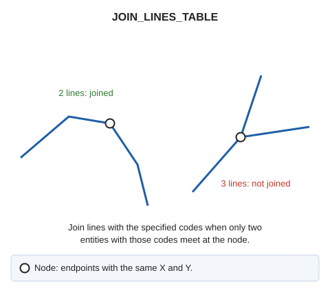

# JOIN\_LINES\_TABLE
<!-- id: unir-lineas-tabla -->
<!-- origen: 171ccebd6a7e006a930494d8b7d253aa448f306a -->

Join lines on screen by code when they have the same code and geometric continuity, provided no more than two entities with that code meet at the node.

## Parameters

| Parameter number | Description | Optional |
| :--- | :--- | :--- |
| 1 | Code or codes (one or more, separated by spaces) | Yes |

If Digi3D.AI rejects any new line, no lines are joined and all originals are retained.

## Command characteristics

| Command type | [Immediate command](/digi3d-ai/referencia/ordenes/ordenes-no-interactivas.md) |
| :--- | :--- |
| Repeats automatically | No |
| Menu option | _This command has no associated menu option_ |
| Toolbar | _This command has no associated toolbar button_ |
| Extension | DigiNG.OrdenesTopologia.dll |
| Implementation | Native |
| Related variables | No related variables |
| Related commands | [JOIN\_LINES](/digi3d-ai/referencia/ventana-de-dibujo/ordenes/u/unir-lineas.md) [JOIN\_VISIBLE\_LINE\_TABLE](/digi3d-ai/referencia/ventana-de-dibujo/ordenes/u/unir-lineas-visibles-tabla.md) [JOIN\_XYZ\_TABLE](/digi3d-ai/referencia/ventana-de-dibujo/ordenes/u/unir-xyz-tabla.md) |
| Internal name | {CD8D1E02-CED4-4EF9-8466-201499CE9A3A} |
