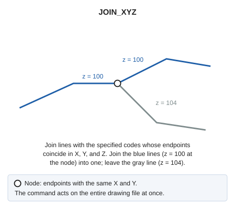

# JOIN\_XYZ
<!-- id: unir-xyz -->
<!-- origen: 9bb907c4f721cfd1d394125e458e8cea163783a4 -->

Join lines bearing codes specified as parameters when they have the same Z at the joining node.

## Parameters

| Parameter number | Description | Optional |
| :--- | :--- | :--- |
| 1 | Code or codes (one or more, separated by spaces) | No |

## Notes

Join only visible lines bearing a specified code. Without codes, do nothing and sound the error tone.

Each line is joined at most once per execution. Run several times to join a chain of more than two lines.

If Digi3D.AI rejects any new line, join no lines and retain all originals.

## Command characteristics

| Command type | [Immediate command](/digi3d-ai/referencia/ordenes/ordenes-no-interactivas.md) |
| :--- | :--- |
| Repeats automatically | No |
| Menu option | Geometric analysis/Join lines if the Z coincides/Regardless of the number of lines getting to the node/Visible lines Geometric analysis/Join lines if the Z coincides/Regardless of the number of lines getting to the node/(one option per code table tag) |
| Toolbar | _This command has no associated toolbar button_ |
| Extension | DigiNG.OrdenesTopologia.dll |
| Implementation | Native |
| Related variables | No related variables |
| Related commands | [JOIN\_LINES](/digi3d-ai/referencia/ventana-de-dibujo/ordenes/u/unir-lineas.md) [JOIN\_XYZ\_TABLE](/digi3d-ai/referencia/ventana-de-dibujo/ordenes/u/unir-xyz-tabla.md) |
| Internal name | {EA135AD0-C148-4861-84EA-9CB29C8F88D0} |
