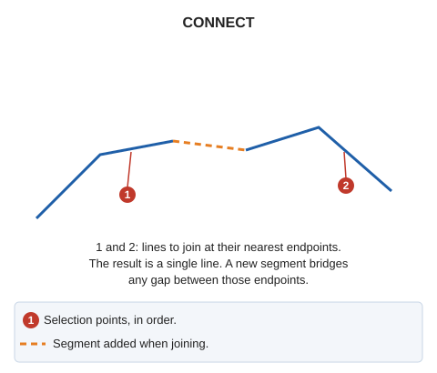
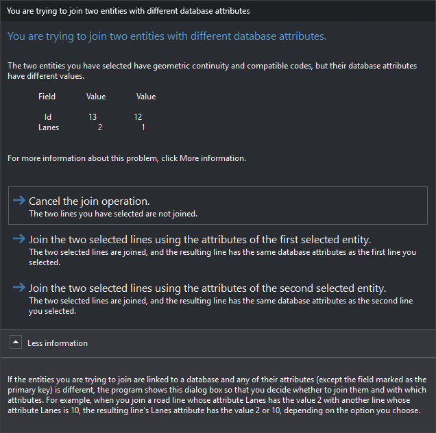

# CONNECT
<!-- id: unir -->
<!-- origen: 6922a8d86356974031ac7edcd711033c576ce17c -->

Join two selected linear entities into a single drawing entity.

## Parameters

| Parameter number | Description | Optional |
| :--- | :--- | :--- |
| 1 | Code of lines to join using a window | Yes |

A code parameter (`CONNECT=<código>`) joins using a window, corresponding to **Join polylines based on window and code** in the menu:

1. Digitize the four window vertices.
2. The command finds visible lines with that code crossing the window. Each pair is joined using the endpoint of each line nearest its window intersection, provided both endpoints have the same Z.

If one line does not belong to the current model, it remains unchanged: the endpoint of the other line is moved to its endpoint.

## Notes

Without parameters, select the two lines. Selection points do not determine which endpoints are joined. The command measures the four horizontal distances between the two sets of endpoints and joins the nearest pair.

Lines with matching codes and database attributes are joined without a prompt. Otherwise:

* Matching codes with differing database attribute values open **Attempting to join two entities with different database attributes**, described below.
* Different codes play the error sound. Subsequent behavior depends on **If the two lines have different codes**, in the **Join** configuration category:
  * **Do not join the lines** (default): "Lines with different code have been selected." appears, and the lines are not joined.
  * **Ask for the code of the line to be generated**: a dialog displays "Selects the codes to be stored in the new geometry", with buttons for the first line codes (default), second line codes, and **Do not join the two lines**.

Two lines with the same code are also treated as having different codes if their database tables differ, or if their IDs differ and the first line has no loaded attributes or their attribute counts differ. With **Do not join the lines**, this displays "The selected lines have the same code, but a different database table or a different database record (ID)."

If quality control rejects the joined line, both originals are retained and no joined line is added. If one line belongs to another model and quality control rejects the modified line, the original remains unchanged. Window joining treats each pair independently.

## Attempting to join two entities with different database attributes dialog

This dialog requests the database attributes for the joined line. It appears when both lines have matching codes but differing attribute values.

A table lists fields with differing values. **Field** contains the field name. The first **Value** column contains the first selected line value; the second contains the second line value. Binary fields and fields marked `comparable="0"` in the database schema are ignored. The primary key (for example, **Id**) is compared unless marked `comparable="0"`; two lines linked to different records therefore always open this dialog, even if all other fields match.

* **Cancel join operation.**: leave lines separate. This is the default.
* **Join them by adapting the attributes of the first selected entity.**: join using the first line codes and attributes.
* **Join them by adapting the attributes of the second selected entity.**: join using the second line codes and attributes.
* **More information**: expand an explanation that differing database attributes cause this dialog, allowing you to decide whether to join and which attributes to use. It says the primary key field is excluded, but that field is actually compared, as the **Id** row in the image shows. Its example joins roads whose Lanes attributes are 2 and 10: the joined line has 2 or 10 lanes depending on the chosen option.

If one line does not belong to the current model, this choice does not change attributes: the line in the current model retains its own.

## Command characteristics

| Command type | [Interactive command](/digi3d-ai/referencia/ordenes/ordenes-interactivas.md) |
| :--- | :--- |
| Repeats automatically | No |
| Menu option | Edit/Polylines/Join two polylines |
| Toolbar | Join |
| Extension | DigiNG.OrdenesStandard.dll |
| Implementation | Native |
| Related variables | No related variables |
| Related commands | [SPR2X](/digi3d-ai/referencia/ventana-de-dibujo/ordenes/e/ext2x.md) [CONNECT\_COD](/digi3d-ai/referencia/ventana-de-dibujo/ordenes/u/unir-cod.md) |
| Internal name | {88F56A67-0638-495d-99FB-6265DAD1CF1B} |
