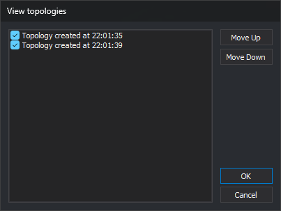

# SEE\_TOPOLOGIES
<!-- id: ver-topologias -->
<!-- origen: 885cdddd27864744925e78ac1ff9f249ac901d98 -->

Show or hide loaded topologies and change their drawing order.

## Parameters

| Parameter number | Description | Optional |
| :--- | :--- | :--- |
| 1 | Topology name | Yes |
| 2 | Visible: `0` hides it; any other number shows it | Yes |

## Notes

Both parameters must be supplied together. If you supply only the name, the command sounds the error tone and does nothing. Enclose names containing spaces in quotes. If no loaded topology has that name, ignoring case, the command changes nothing.

With parameters, the command does not display a dialog box: it shows or hides the specified topology and refreshes the view. The _Topology/View_ menu options run the command this way: _All topologies_, _No topology_, and one option per loaded topology, selected if that topology is visible.

### Example

`SEE_TOPOLOGIES="Topología creada a las 11:15:27" 0`

### Dialog box

Without parameters, the _View topologies_ dialog box asks which topologies to display and in what order. If no topology is loaded, the command sounds the error tone, displays _No topological file can be modified as none is loaded_, and ends.

The list contains loaded topologies in their current drawing order. Each topology has a checkbox selected if it is visible.

| Control | Description |
| :--- | :--- |
| Topology list | Select the topologies to display. Topologies are drawn in list order, from top to bottom: each is drawn after those above it |
| Move Up | Move the selected topology up one position. Sound the error tone if none is selected or it is already first |
| Move Down | Move the selected topology down one position. Sound the error tone if none is selected or it is already last |

Click _OK_ to apply list order and visibility, refresh the view, and sound a tone. Click _Cancel_ to end without changing order or visibility.

## Command characteristics

| Command type | Immediate command |
| :--- | :--- |
| Repeats automatically | No |
| Menu option | Topology/View/All topologies Topology/View/No topology Topology/View/(one option per loaded topology) |
| Toolbar | _This command has no associated toolbar button_ |
| Extension | DigiNG.OrdenesTopologia.dll |
| Implementation | Native |
| Related variables | No related variables |
| Related commands | [BINTOP](/digi3d-ai/referencia/ventana-de-dibujo/ordenes/b/bintop.md) |
| Internal name | {EA4A64CD-BD28-43B0-A499-C44500C57813} |
