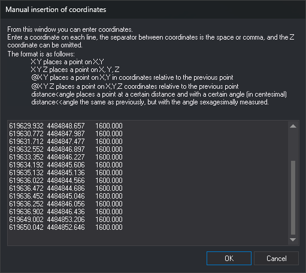

# XY
<!-- id: xy -->
<!-- origen: 3913a9db6d9a440c4da49b1b5723bdc6ef9301ff -->

Pass the coordinates of one or more points, typed as parameters or in a dialog box, to the command currently running.

## Parameters

| Parameter number | Description | Values | Optional |
| :--- | :--- | :--- | :--- |
| 1, 2, 3 | X, Y, and Z coordinates of the first point | Real number | Yes |
| 4, 5, 6... | X, Y, and Z coordinates of subsequent points, in groups of three | Real number | Yes |

Parameters are always absolute coordinates. If the last point has only X and Y, its Z is 0; if it has only X, the command discards it.

Without parameters, or with only one, the command displays the _Manual insertion of coordinates_ dialog box.

## Notes

The command passes each point to the running command as if the data button had been pressed and released at those coordinates. While sending the points, it disables the mouse and timeout, then restores them when finished. It then finishes.

### Dialog box

Use this dialog box to specify the points to pass to the running command.

Type one point per line. Lines can end in CR LF, LF, or CR. Separate values with spaces, tabs, commas, or `=`. Each line accepts one of these formats:

| Format | Meaning |
| :--- | :--- |
| `X Y` | Absolute coordinates. Z is the previous point's Z, or 0 if there is no previous point |
| `X Y Z` | Absolute coordinates with Z |
| `@dX dY` | Offset from the previous point, preserving Z |
| `@dX dY dZ` | Offset from the previous point, including Z |
| `distancia<ángulo` | Distance and angle in gradians relative to the previous point, preserving Z. The angle is measured counterclockwise from the X axis |
| `distancia<<ángulo` | Distance and angle in degrees relative to the previous point, preserving Z. The angle is measured counterclockwise from the X axis |

Polar coordinates (`<` and `<<`) are always relative to the previous point and do not use `@`. In a line starting with `@`, `<` does not indicate polar coordinates: `@10<50` has only one value and the command ignores it.

The command ignores empty lines, lines with only one value, and values after the third. A value that does not start with a number counts as 0; if it starts with a number, the command uses that number and ignores the rest of the value.

For the first line, the previous point is the last vertex of the running command. Commands that provide it include [LINE](/digi3d-ai/referencia/ventana-de-dibujo/ordenes/l/linea.md), [POL](/digi3d-ai/referencia/ventana-de-dibujo/ordenes/p/pol.md), [2P](/digi3d-ai/referencia/ventana-de-dibujo/ordenes/2/2p.md), [3P](/digi3d-ai/referencia/ventana-de-dibujo/ordenes/3/3p.md), and [RECTANGLE\_DR](/digi3d-ai/referencia/ventana-de-dibujo/ordenes/r/rectangulo-dr.md). For subsequent lines, the previous point is the point from the preceding line.

If there is no previous point because no command is running, the command does not provide its last vertex, or it has no vertices yet, the first line that is not ignored must contain absolute coordinates. Otherwise, the command displays _Error: The first point cannot be relative, it must be absolute._ and sends no points.

Click _Cancel_ to finish without sending any points. The dialog box contents are not preserved for the next execution.

## Command characteristics

| Command type | [Immediate command](/digi3d-ai/referencia/ordenes/ordenes-no-interactivas.md) |
| :--- | :--- |
| Repeats automatically | No |
| Menu option | Immediate/Manual insertion of coordinates |
| Toolbar | Coordinates |
| Extension | DigiNG.OrdenesStandard.dll |
| Implementation | Native |
| Related variables | No related variables |
| Related commands | [2P](/digi3d-ai/referencia/ventana-de-dibujo/ordenes/2/2p.md) [3P](/digi3d-ai/referencia/ventana-de-dibujo/ordenes/3/3p.md) [LINE](/digi3d-ai/referencia/ventana-de-dibujo/ordenes/l/linea.md) [POL](/digi3d-ai/referencia/ventana-de-dibujo/ordenes/p/pol.md) [RECTANGLE\_DR](/digi3d-ai/referencia/ventana-de-dibujo/ordenes/r/rectangulo-dr.md) [XYLINE](/digi3d-ai/referencia/ventana-de-dibujo/ordenes/x/xylinea.md) [XYZLINE](/digi3d-ai/referencia/ventana-de-dibujo/ordenes/x/xyzlinea.md) |
| Internal name | {140CD659-1BAF-4db6-A70B-2DB907255CB2} |
