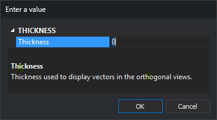

# THICKNESS
<!-- id: grosor -->
<!-- origen: 14768c78ae0e92b25e0261ef3903a44b20dbfc67 -->

Add extra thickness to entities displayed in the drawing window.

## Parameters

| Parameter number | Description | Values | Optional |
| :--- | :--- | :--- | :--- |
| 1 | Extra thickness in pixels | Integer, or **?** to display the current value in a balloon | Yes |

If you run the command without parameters, it displays the **Enter a value** dialog box:

The dialog box closes and accepts the value when you press **Enter** or **Escape**, or confirm the change in the field.

## Notes

The thickness of each entity in the drawing window is its line thickness plus the value of this variable. The line thickness comes from the entity if it has an assigned thickness, or from its code in the code table otherwise. The resulting thickness is never less than 1 pixel, so a negative value makes entities thinner down to that minimum.

Changing the value refreshes the drawing window. Querying the value with `THICKNESS=?` does not refresh anything.

The value is 0 when Digi3D.AI starts and is not saved between sessions.

A nonnumeric parameter is interpreted as 0.

To change the thickness in the photogrammetric window, use [STHICKNESS](grosors.md).

### Examples

`THICKNESS=2`

Add 2 pixels to the thickness of entities in the drawing window.

`THICKNESS=?`

Display the current value in a balloon.

## Command characteristics

| Command type | [Numeric variable](../../../ordenes/variables/variables-numericas.md) |
| :--- | :--- |
| Repeats automatically | No |
| Menu option | _This command has no associated menu option_ |
| Toolbar | _This command has no associated toolbar button_ |
| Extension | DigiNG.OrdenesStandard.dll |
| Implementation | Native |
| Related variables | [STHICKNESS](grosors.md) |
| Internal name | {D8D7E7B7-322C-4bbb-9BCD-43B0E71DD457} |
