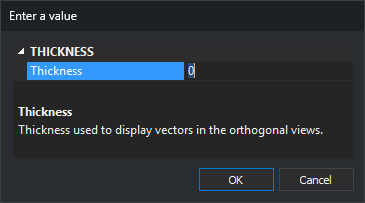

# STHICKNESS
<!-- id: grosors -->
<!-- origen: 1a46d930b05b9062e454506a0f694d81854813f3 -->

Add extra thickness to vectors displayed in the photogrammetric window.

## Parameters

| Parameter number | Description | Values | Optional |
| :--- | :--- | :--- | :--- |
| 1 | Extra thickness in pixels | Integer, or **?** to display the current value in a balloon | Yes |

If you run the command without parameters, it displays the **Enter a value** dialog box:

The dialog box closes and accepts the value when you press **Enter** or **Escape**, or confirm the change in the field.

## Notes

The thickness of each vector in the photogrammetric window is its code stereo thickness in the code table plus the value of this variable. The entity thickness is not used. The resulting thickness is never less than 1 pixel, so a negative value makes vectors thinner down to that minimum.

Changing the value refreshes the vectors in all open photogrammetric windows. Querying the value with `STHICKNESS=?` does not refresh anything.

The value is 0 when Digi3D.AI starts and is not saved between sessions.

A nonnumeric parameter is interpreted as 0.

To change the thickness in the drawing window, use [THICKNESS](grosor.md).

### Examples

`STHICKNESS=2`

Add 2 pixels to the thickness of vectors in the photogrammetric window.

`STHICKNESS=?`

Display the current value in a balloon.

## Command characteristics

| Command type | [Numeric variable](../../../ordenes/variables/variables-numericas.md) |
| :--- | :--- |
| Repeats automatically | No |
| Menu option | _This command has no associated menu option_ |
| Toolbar | _This command has no associated toolbar button_ |
| Extension | DigiNG.OrdenesStandard.dll |
| Implementation | Native |
| Related variables | [THICKNESS](grosor.md) |
| Internal name | {0D98E9B2-1EA9-45bc-B450-25905BDED0AE} |
