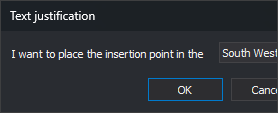

# JT
<!-- id: jt -->
<!-- origen: 642a07bcc760c7773fc626122fa998df16daf068 -->

Set the active text justification: the position of the insertion point relative to the text created by text drawing commands.

## Parameters

| Parameter number | Description | Values | Optional |
| :--- | :--- | :--- | :--- |
| 1 | Text justification | Integer from 0 to 8 (see the following table), or **?** to display the current value in a balloon | Yes |

| Value | Insertion point position |
| :--- | :--- |
| 0 | South West: bottom-left corner |
| 1 | West: center of the left side |
| 2 | North West: top-left corner |
| 3 | North: center of the top side |
| 4 | North East: top-right corner |
| 5 | East: center of the right side |
| 6 | South East: bottom-right corner |
| 7 | South: center of the bottom side |
| 8 | Center of the text |

If you run the command without parameters, it displays the **Text justification** dialog box:

The drop-down list shows the active justification when the dialog box opens. **OK** sets the selected position as the active justification. **Cancel** closes the dialog box without changing the value.

## Notes

Commands that create text, such as [TEXT](../../ordenes/t/texto.md), [TEXT\_R](../../ordenes/t/texto-r.md), [1TEXT](../../ordenes/1/1-texto.md), [HEIGHT](../../ordenes/c/cota.md), [AREA](../../ordenes/a/area.md), [TAG\_CONTOURS](../../ordenes/r/rotula-curvas.md), [TAG\_Z](../../ordenes/r/rotula-z.md), [LOAD\_T](../../ordenes/c/carga-t.md), or [LOAD\_P](../../ordenes/c/carga-p.md), apply this justification to new text. [CHNG\_JT](../../ordenes/c/camb-jt.md) and [CHNG\_JT2](../../ordenes/c/camb-jt2.md) apply it to existing text.

If [FORCE\_ACTIVE\_JT](../f/forzar-jt-activa.md) is enabled, commands that copy or duplicate text, such as [COPY](../../ordenes/c/copiar.md), [COPYP](../../ordenes/c/copia-2p.md), or [COPY\_R](../../ordenes/c/copia-r.md), store the text with this justification instead of its original justification.

Applying [CLONE](../../ordenes/c/clonar.md) to text sets its justification as the active justification.

A negative value or a value greater than 8 is stored as 0. A nonnumeric parameter is interpreted as 0. If the parameter starts with a number, that number is used and the rest is ignored.

The value is 0 (South West) when Digi3D.AI starts and is not saved between sessions.

The menu option and toolbar buttons run this command with the corresponding value and show the active value as selected.

### Examples

`JT=3`

Place the insertion point at the center of the top side of the text.

`JT=?`

Display the active justification in a balloon, for example **Justification: (3) north**.

## Command characteristics

| Command type | [Numeric variable](../../../ordenes/variables/variables-numericas.md) |
| :--- | :--- |
| Repeats automatically | No |
| Menu option | Draw/Text justification/South West Draw/Text justification/West Draw/Text justification/North West Draw/Text justification/North Draw/Text justification/North East Draw/Text justification/East Draw/Text justification/South East Draw/Text justification/South Draw/Text justification/Center |
| Toolbar | Texts (drop-down button with the Text justification toolbar, one button per value) |
| Extension | DigiNG.OrdenesStandard.dll |
| Implementation | Native |
| Related variables | [FORCE\_ACTIVE\_JT](../f/forzar-jt-activa.md) |
| Internal name | {77F3855D-5146-436f-AEB1-9468D43AE611} |
