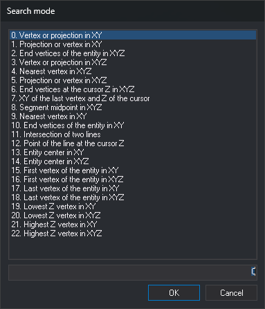

# SMODE
<!-- id: modob -->
<!-- origen: a21d28e883fd5cd4d318d7ae6c4b62d0e0dc55c0 -->

Set the search mode: the point on a drawing entity to which a snap attaches.

## Parameters

| Parameter number | Description | Values | Optional |
| :--- | :--- | :--- | :--- |
| 1 | Primary search mode | Integer from 0 to 22 | Yes |
| 2 and subsequent | Secondary search modes | Integers from 0 to 22 | Yes |

Without parameters, the command displays **Search mode**:

The list displays all 23 modes with the active mode selected. The field below displays the selected mode number. Typing a number in the field selects that mode in the list.

**OK** activates the selected mode as the sole search mode and discards secondary modes. Double-clicking a mode is equivalent to selecting it and clicking **OK**. If the field does not contain a number from 0 to 22, **OK** displays a warning and the dialog box stays open. **Cancel** closes the dialog box without changing the mode and plays an error sound.

## Notes

If the first parameter is outside the range 0 to 22, the command plays an error sound and leaves the mode unchanged. Secondary modes outside that range are discarded. A nonnumeric parameter is interpreted as 0, so `SMODE=?` activates mode 0 instead of querying the value.

The mode is 0 when Digi3D.AI starts and is not saved between sessions. All drawing windows share the same mode. The [Snap](../../../barras-de-herramientas/tentativo.md) toolbar drop-down list displays the active mode and lets you change it. With multiple active modes, it displays their numbers separated by `|`, such as `12 | 1`.

Use [CHNG\_SMODE](../../ordenes/c/camb-modob.md) to switch to the next mode.

### Search area

Snapping analyzes entities at a distance from the cursor less than or equal to the cursor size plus 3 pixels. Set the cursor size with [CURSOR](../../ordenes/c/cursor.md). Distance is measured in screen pixels, so the area in ground coordinates depends on the zoom. In mode 11, the distance is the cursor size plus 1 pixel.

### Secondary modes

With multiple modes, snapping tries them in parameter order for each entity in the search area and uses the first mode that finds a point. If no mode finds a point on that entity, snapping proceeds to the next entity in the area.

Modes 7 and 11 work only as the sole mode. In a list of multiple modes, they find no points.

### Z coordinate

In XY modes, the point takes X and Y from the entity and Z from the cursor. In XYZ modes, it takes all three coordinates from the entity. If [FIXZ](../f/fijaz.md) is enabled, the point takes the [Z](../z/z.md) variable value in all modes.

### Search modes

| Value | Name | Description |
| :--- | :--- | :--- |
| 0 | Vertex or projection in XY | Snap to an entity vertex if one is within the search area. Otherwise, snap to the cursor projection on the nearest segment. |
| 1 | Projection or vertex in XY | Snap to the cursor projection on the nearest segment if that projection is within the search area. Otherwise, snap to the nearest vertex. |
| 2 | End vertices of the entity in XYZ | Snap to the entity's first or last vertex, whichever is within the search area. If both are inside, snap to the one nearer the cursor. If neither is inside, do not snap to that entity. |
| 3 | Vertex or projection in XYZ | Same as mode 0, using the entity's Z at the snap point. |
| 4 | Nearest vertex in XYZ | Snap to the vertex nearest the cursor. If the cursor is nearer a segment than any vertex, snap to that segment's end nearest the cursor, even if the end is outside the search area. |
| 5 | Projection or vertex in XYZ | Same as mode 1, using the entity's Z at the snap point. |
| 6 | End vertices at the cursor Z in XYZ | Same as mode 2, but consider only ends whose Z equals the cursor Z. Use this to continue a contour line at the same Z. |
| 7 | XY of the last vertex and Z of the cursor | Do not search entities. During [LINE](../../ordenes/l/linea.md) and [SELECT\_POLYGON](../../ordenes/s/selecciona-poligono.md), snapping records a point with the last recorded vertex's X and Y and the cursor Z. If no vertex exists yet, play an error sound. Outside these commands, snap to nothing. |
| 8 | Segment midpoint in XYZ | For lines, snap to the midpoint of the segment nearest the cursor. For other entities, snap to the nearest vertex. |
| 9 | Nearest vertex in XY | Same as mode 4, using the cursor Z. |
| 10 | End vertices of the entity in XY | Same as mode 2, using the cursor Z. |
| 11 | Intersection of two lines | Snap to the intersection of two lines. See [Mode 11](#mode-11-intersection-of-two-lines). |
| 12 | Point of the line at the cursor Z | For lines with a segment within the search area, interpolate between vertices to calculate points on the line whose Z equals the cursor Z, then snap to the one nearest the cursor in XY. If the line does not reach that Z, do not snap. For other entities, snap to the nearest vertex in XYZ. Use this to make a contour pass through a 3D line, such as a river or path. |
| 13 | Entity center in XY | Snap to the center of the entity's bounding rectangle, even if that center is outside the search area. |
| 14 | Entity center in XYZ | Same as mode 13. Z is the mean of the entity's minimum and maximum Z. |
| 15 | First vertex of the entity in XY | Snap to the first vertex, even if it is outside the search area. |
| 16 | First vertex of the entity in XYZ | Same as mode 15, using the vertex Z. |
| 17 | Last vertex of the entity in XY | Snap to the last vertex, even if it is outside the search area. |
| 18 | Last vertex of the entity in XYZ | Same as mode 17, using the vertex Z. |
| 19 | Lowest Z vertex in XY | Snap to the entity's vertex with the lowest Z. If several exist, snap to the one nearest the cursor. |
| 20 | Lowest Z vertex in XYZ | Same as mode 19, using the vertex Z. |
| 21 | Highest Z vertex in XY | Snap to the entity's vertex with the highest Z. If several exist, snap to the one nearest the cursor. |
| 22 | Highest Z vertex in XYZ | Same as mode 21, using the vertex Z. |

In modes 13 through 22, the entity only needs to pass through the search area. The snap point can be outside it.

### Mode 11: intersection of two lines

With mode 11 as the sole mode, snapping searches visible lines with a segment within the search area and pairs of these lines that intersect within it. Only line entities are considered. If no two lines intersect within the area, an error sound plays.

The point takes X and Y from the intersection nearest the cursor and Z from the first line. Each new press of the snap button changes the proposed point: first to the second line's Z, then to the next pair of lines. When no pairs remain, snapping plays an error sound and finishes. The data button accepts the point.

### Automatic search mode

If [AUTOSMODE](../../ordenes/a/automodob.md) is enabled and a table is loaded with [AUTO\_SMODE\_PARAMETERS](../../ordenes/p/parametros-auto-modob.md), snapping replaces the search mode with the one the table assigns to the active code and the code of each entity analyzed. If no row matches that code combination, snapping activates mode 0. If the table lacks the combination and [EXHAUSTIVE\_AUTOSMODE](../../ordenes/a/automodob-exhaustivo.md) is enabled, snapping discards the entity instead of activating mode 0. The mode set by snapping remains active after the snap finishes.

### Examples

`SMODE=4`

Activate mode 4.

`SMODE=12 1`

Activate mode 12 with mode 1 as secondary. On entities where mode 12 finds no point at the cursor Z, snap to the projection or vertex in XY.

## Command characteristics

| Command type | [Non-interactive command](../../../ordenes/ordenes-no-interactivas.md) |
| :--- | :--- |
| Repeats automatically | No |
| Menu option | _This command has no associated menu option_ |
| Toolbar | [Snap](../../../barras-de-herramientas/tentativo.md) (search mode drop-down list) |
| Extension | DigiNG.OrdenesStandard.dll |
| Implementation | Native |
| Related variables | [CHNG\_SMODE](../../ordenes/c/camb-modob.md) [AUTOSMODE](../../ordenes/a/automodob.md) [CURSOR](../../ordenes/c/cursor.md) [FIXZ](../f/fijaz.md) |
| Internal name | {4B0321A1-67A4-4209-89A9-3F55C6AB2539} |
