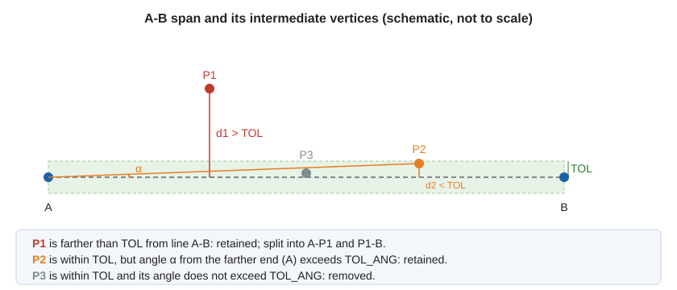

# TOL\_ANG
<!-- id: tol-ang-2 -->
<!-- origen: ca115194d30c5497ca6a5749e993df5a66875f62 -->

Set the _angular tolerance factor_ for [generalization](/digi3d-ai/referencia/ventana-de-dibujo/ordenes/g/gen.md).

## Parameters

| Parameter number | Description | Values | Optional |
| :--- | :--- | :--- | :--- |
| 1 | Numeric value. If omitted, the status bar displays a text box for entering the value. | Real number or **?** | Yes |

### Examples

`TOL_ANG=45`

Set the angular tolerance to 45 degrees.

`TOL_ANG=?`

Display the current angular tolerance.

## Notes

Enter the value in **degrees**. The initial value when Digi3D.AI starts is 4.58, and assigned values are not preserved when the application closes.

Angular tolerance applies only to a span in which no vertex's distance from the straight line through the span's ends exceeds the [linear tolerance](/digi3d-ai/referencia/ventana-de-dibujo/variables/t/tol.md). When angular tolerance applies, [GEN](/digi3d-ai/referencia/ventana-de-dibujo/ordenes/g/gen.md) and [GEN\_2D](/digi3d-ai/referencia/ventana-de-dibujo/ordenes/g/gen-2d.md) calculate each intermediate vertex's deviation angle α from that line, viewed from the end **farther** from the vertex. If the greatest angle exceeds **TOL\_ANG**, retain that vertex to preserve the entity's shape and split the span in two at that vertex.

With **TOL\_ANG** set to 0, no vertex is removed unless it is exactly aligned with the span's ends: any angle greater than 0 retains it.

## Command characteristics

| Command type | [Real variable](/digi3d-ai/referencia/ordenes/variables/variables-reales.md) |
| :--- | :--- |
| Repeats automatically | No |
| Menu option | _This command has no associated menu option_ |
| Toolbar | _This command has no associated toolbar button_ |
| Extension | DigiNG.OrdenesStandard.dll |
| Implementation | Native |
| Related variables | [TOL](/digi3d-ai/referencia/ventana-de-dibujo/variables/t/tol.md) |
| Internal name | {CAF1F0F2-7F03-4a0f-804C-B9E411772E09} |
