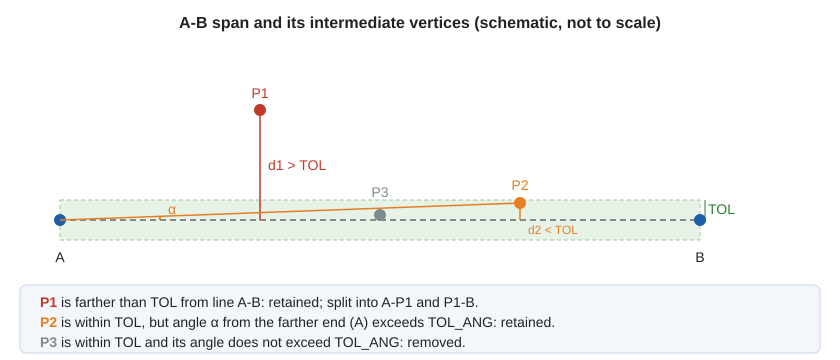

# TOL
<!-- id: tol-2 -->
<!-- origen: e0a743276e67d55e3c7ead624217daead88704eb -->

Set the _tolerance factor_ for [generalization](/digi3d-ai/referencia/ventana-de-dibujo/ordenes/g/gen.md).

## Parameters

| Parameter number | Description | Values | Optional |
| :--- | :--- | :--- | :--- |
| 1 | Numeric value. If omitted, the status bar displays a text box for entering the value; you can also digitize two points to assign the distance between them. | Real number or **?** | Yes |

### Examples

`TOL=10`

Set the tolerance factor to 10 m.

`TOL=?`

Display the current tolerance factor.

## Notes

Enter the _tolerance factor_ in the drawing file's coordinate units \(meters in a projected coordinate reference system\). Its initial value is the generalization tolerance from the drawing file settings, and it is reassigned each time a drawing file is opened.

[GEN](/digi3d-ai/referencia/ventana-de-dibujo/ordenes/g/gen.md) and [GEN\_2D](/digi3d-ai/referencia/ventana-de-dibujo/ordenes/g/gen-2d.md) use the Douglas-Peucker algorithm. For each span of the entity, they calculate the distance of each intermediate vertex from the **straight line through the span's ends**, rather than from the segment joining the preceding and following vertices:

* If any vertex is farther than **TOL**, retain the farthest vertex and split the span in two at that vertex.
* If no vertex is farther than **TOL** from the straight line through the span's ends, vertex retention depends on the angular tolerance [TOL\_ANG](/digi3d-ai/referencia/ventana-de-dibujo/variables/t/tol-ang.md).

`GEN` measures distance in 3D space, including Z; `GEN_2D` measures only in the XY plane.

## Command characteristics

| Command type | [Real variable](/digi3d-ai/referencia/ordenes/variables/variables-reales.md) |
| :--- | :--- |
| Repeats automatically | No |
| Menu option | _This command has no associated menu option_ |
| Toolbar | _This command has no associated toolbar button_ |
| Extension | DigiNG.OrdenesStandard.dll |
| Implementation | Native |
| Related variables | [TOL\_ANG](/digi3d-ai/referencia/ventana-de-dibujo/variables/t/tol-ang.md) |
| Internal name | {57647E08-06CB-448b-BD9A-639C5008A176} |
