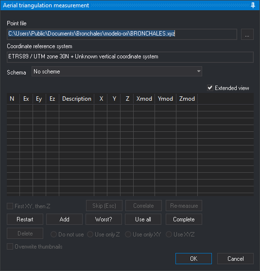

# AEROTRI
<!-- id: aerotri -->
<!-- origen: ca2ff237f14fe759e819f513c17bed8cbf2a2d63 -->

Measures aerial triangulation and control points in the loaded model and saves model and photo coordinates for an aerial triangulation adjustment program.

## Parameters

None.

## Aerial triangulation measurement pane

AEROTRI shows this pane and [Thumbnails](../../../paneles/instantaneas.md). AEROTRI first loads the control point file. If loading fails, Digi3D.AI displays “Warning: Unable to load control point file” and opens [Control point file](../../../cuadros-de-dialogo/archivo-de-puntos-de-apoyo.md). Cancelling that dialog ends AEROTRI.

Uses the [ABSOLUTE\_ORI](../o/ori-absoluta.md) pane with these differences:

* **Schema**: aerial triangulation measurement pattern. Read from [Schemas](../../../cuadros-de-dialogo/configuracion/medida-de-aerotriangulacion/esquemas.md). Each point has a prefix, photo position and suffix. Its name combines prefix, photo name and suffix. The pattern applies first to the left photo, then the right. Selecting a pattern moves to the first unmeasured point and runs [CORRELATE](../c/correlar.md). The last pattern is remembered.
  * An existing _.mod_ from earlier measurement loads its points and disables **Schema**.
  * With no configured schema file, **Schema** is empty and points are measured with **Add**.
  * An unreadable schema file displays “Error in the schema file format” and ends the command.
* **Add**: opens [Enter a terrain point of the point file](../../../cuadros-de-dialogo/introduce-punto-terreno.md). A name absent from the control point file is measured as an aerial triangulation point: no ground coordinates or residuals, and its use cannot change through **Do not use**, **Use on Z**, **Use on XY** or **Use on XYZ**.
* Points already measured in another model's images use their photo coordinates to position the cursor.
* After traversing the pattern, with at least two measured control points, requests control file points lying inside the model.
* **OK** is available even without measured points, except while remeasuring one.

**OK** writes in the project's **Aerotriangulación** folder:

* A _model name.mod_ containing model coordinates multiplied by 1000 for both projection centers and measured points not marked **Do not use**.
* One photo coordinate file per photo, containing its measured points.

The pane's absolute orientation calculated from control points is used only for moving to them. Closing with **OK** or **Cancel** restores the model's absolute orientation from before the command.

## Command characteristics

| Command type | Interactive command |
| :--- | :--- |
| Repeats automatically | No |
| Menu option | Photogrammetric window/Measure aerotriangulation (option added by the conical camera sensor) |
| Toolbar | _This command has no associated toolbar button_ |
| Extension | Digi3D.ConicSensor.dll |
| Implementation | Native |
| Related variables | No related variables |
| Related commands | [ABSOLUTE\_ORI](/digi3d-ai/referencia/ventana-fotogrametrica/ordenes/o/ori-absoluta.md) [CORRELATE](/digi3d-ai/referencia/ventana-fotogrametrica/ordenes/c/correlar.md) |
| Internal name | {3992CC17-D66C-4998-9B6E-FE69E0E4D4F7} |
