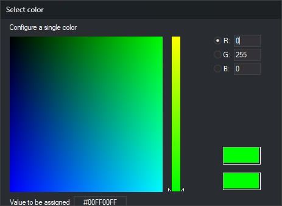

# POINTER\_COLOUR
<!-- id: color-indice -->
<!-- origen: a73767dd8d19c9536518cf7875e7daf78794c7fa -->

Changes the color of the cursors in the stereoscopic display.

## Parameters

| Parameter number | Description | Optional |
| :--- | :--- | :--- |
| 1 | Red component, from 0 to 255 | Yes |
| 2 | Green component, from 0 to 255 | Yes |
| 3 | Blue component, from 0 to 255 | Yes |

With no parameters, opens the color selection dialog. With all three parameters, assigns the color to both cursors without opening the dialog. With one or two parameters, leaves the color unchanged and plays the error sound.

### Example

`POINTER_COLOUR=0 255 0`

## Notes

With no parameters, opens the dialog where you can select the color:

Click **OK** or press Enter to apply the values entered in R (red), G (green) and B (blue), without clicking the color. The hexadecimal value field is read-only.

The selected color applies to both cursors.

## Command characteristics

| Command type | Interactive command without parameters; immediate command with parameters |
| :--- | :--- |
| Repeats automatically | No |
| Menu option | Photogrammetric window/Cursor/Color |
| Toolbar | _This command has no associated toolbar button_ |
| Extension | Digi3D.CommonCommands.dll |
| Implementation | Native |
| Related variables | No related variables |
| Related commands | [CH\_POINTER\_BRIGHTNESS](/digi3d-ai/referencia/ventana-fotogrametrica/ordenes/c/cambia-brillo-indice.md) |
| Internal name | {F3F80700-4479-45ff-89D2-10E8F5C12F3E} |
