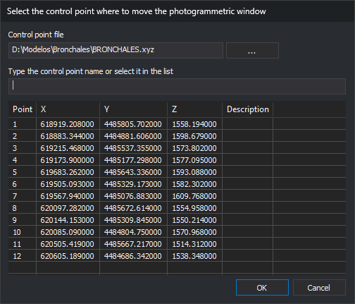

# GO\_TO\_CONTROL\_POINT
<!-- id: ir-a-punto-apoyo -->
<!-- origen: 5c786ca13ad68fd4b4611ec401fbb37b3799e0a1 -->

Moves the plotter to a control point selected from a point file.

## Parameters

None.

## Notes

Reads the point file path from registry value `ArchivoPuntos`, also used by [Photogrammetric sensors](/digi3d-ai/referencia/cuadros-de-dialogo/nuevo-proyecto/sensores-fotogrametricos.md) in **New project**. If empty or nonexistent, requests a file in Windows file selection and saves its path there. Cancelling ends with the error sound.

Then requests a point in **Select the control point where to move the photogrammetric window**.

* **Control point file**: loaded file path. **...** opens **Select control point file**. After you select a file, GO_TO_CONTROL_POINT saves the selected file path in `ArchivoPuntos`.
* **Type the control point name or select it in the list**: typing selects an exact match or the first name beginning with the entered text, ignoring case. No match clears selection.
* The list has **Point**, **X**, **Y**, **Z** and **Description**. Each file line with at least four values \(name, X, Y, Z\) is a point; remaining text is its description. Other lines are ignored.

Initially the name field has focus. Enter or select a point and click **OK** or press **Enter**, or double-click a point. No selected point plays a warning and leaves the dialog open.

Moves the plotter to ground coordinates and beeps. Cancelling ends with the error sound.

Does not check whether relative and absolute orientations are complete.

The resizable dialog saves size and position.

## Command characteristics

| Command type | Interactive command |
| :--- | :--- |
| Repeats automatically | No |
| Menu option | Photogrammetric window/Go to control point... |
| Toolbar | _This command has no associated toolbar button_ |
| Extension | Digi3D.CommonCommands.dll |
| Implementation | Native |
| Related variables | No related variables |
| Related commands | [GO\_TO](/digi3d-ai/referencia/ventana-de-dibujo/ordenes/i/ir-a.md) [GO\_TO\_ORIGIN\_POINT](/digi3d-ai/referencia/ventana-fotogrametrica/ordenes/i/ir-a-punto-origen.md) |
| Internal name | {9FCD076A-DD12-42a7-980E-FC2392C95419} |
