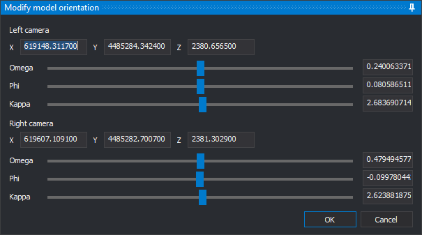

# MODIFY\_MODEL\_PARAMETERS
<!-- id: modificar-parametros-modelo -->
<!-- origen: e1395a33f060c5ddfe140c57497474007bc20b12 -->

MODIFY_MODEL_PARAMETERS manually changes the positions and rotations of both cameras in the conical camera model loaded in the photogrammetric window. The images reflect changes as you edit the parameters.

## Parameters

None.

## Modify model orientation pane

The pane has one group of controls for the **Left camera** and another for the **Right camera**. Initial values come from the model's relative orientation.

* **X**, **Y**, **Z**: projection center coordinates in the model coordinate system.
* **Omega**, **Phi**, **Kappa**: camera rotations in degrees, applied in omega, phi, kappa order. Each rotation has a slider and a field. Rotations range from -180 to 180 degrees. Sliders move in 0.01-degree steps; fields accept any value within the range.

Each change applies to the images immediately, whether you move a slider or enter a valid value. While a field contains nonnumeric text or an out-of-range rotation, for example while you type the minus sign of a negative value, the images remain unchanged.

* **OK**: validates all twelve fields and ends the command. If a field is invalid, displays a message and leaves the pane open. The changed orientation is used while the model is loaded; it is not saved in the orientation files.
* **Cancel**: restores both cameras to their orientation when the command started and ends the command.

If you run another command while this pane is open, clicking **OK** or **Cancel** plays the error sound. Neither button performs any action until the other command finishes.

## Command characteristics

| Command type | Interactive command |
| :--- | :--- |
| Repeats automatically | No |
| Menu option | Photogrammetric window/Modify model orientation (option added by the conical camera sensor) |
| Toolbar | _This command has no associated toolbar button_ |
| Extension | Digi3D.ConicSensor.dll |
| Implementation | Native |
| Related variables | No related variables |
| Related commands | [RELATIVE\_ORI](/digi3d-ai/referencia/ventana-fotogrametrica/ordenes/o/ori_relativa.md) [CAMERA\_ROTATIONS](/digi3d-ai/referencia/ventana-fotogrametrica/ordenes/r/rotaciones-camaras.md) |
| Internal name | {22F02A11-BB26-444D-89B3-43D0F41803CB} |
