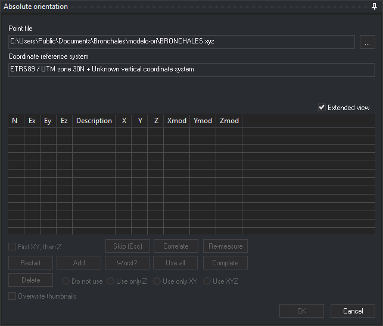

# ABSOLUTE\_ORI
<!-- id: ori-absoluta -->
<!-- origen: 722557979d014d5175a4b5cb51ad11681a9ba730 -->

Performs the **absolute orientation** of the model loaded in the photogrammetric window.

## Parameters

None.

## Absolute orientation pane

ABSOLUTE_ORI opens **Absolute orientation**, where you measure control points and view orientation residuals. Buttons are disabled when their actions are unavailable.

* **Point file**: file containing the control points' ground coordinates. **...** opens [Control point file](../../../cuadros-de-dialogo/archivo-de-puntos-de-apoyo.md) to change it.
* **Coordinate reference system**: coordinate system of the point file.
* **Extended view**: adds each point's ground coordinates (**X**, **Y**, **Z**) and model coordinates (**Xmod**, **Ymod**, **Zmod**) to the list. Digi3D.AI remembers this setting.
* **Measured point list**: shows each point's name (**N**), X, Y and Z residuals (**Ex**, **Ey**, **Ez**) and **Description**. Click a point to move the cursor to it. Double-click to also remeasure it.
* **First XY, then Z**: measures each point in two steps: the first data input records its plan position and the second records Z.
* **Skip (Esc)**: while waiting for a point measurement, skips that point and moves to the next. With a point selected in the list, clears selection.
* **Correlate**: runs CORRELATE to adjust the position in the other image automatically.
* **Re-measure**: moves the cursor to the selected point for remeasurement.
* **Restart**: remeasures every point in turn.
* **Add**: measures a new point. Opens [Enter a terrain point of the point file](../../../cuadros-de-dialogo/introduce-punto-terreno.md) to select it.
* **Worse?**: selects the point with the largest residual. Requires at least three measured points.
* **Use all**: uses X, Y and Z of every measured point again.
* **Complete**: goes through the file's points that remain unmeasured.
* **Delete**: removes the selected point and recalculates the orientation.
* **Do not use**, **Use on Z**, **Use on XY** and **Use on XYZ**: choose which coordinates of the selected point participate in the calculation.
* **Overwrite thumbnails**: when measuring a point, Digi3D.AI saves a thumbnail of each image in the project's thumbnail folder. Checked, replaces existing thumbnails; unchecked, creates only missing ones.
* **OK**: saves the orientation and ends the command. Available only with enough points to calculate it.
* **Cancel**: ends the command without saving the orientation.

## Command characteristics

| Command type | Interactive command |
| :--- | :--- |
| Repeats automatically | No |
| Menu option | Photogrammetric window/Absolute orientation (option added by the conical camera sensor) |
| Toolbar | _This command has no associated toolbar button_ |
| Extension | Digi3D.ConicSensor.dll |
| Implementation | Native |
| Related variables | No related variables |
| Related commands | [INNER\_ORI\_R](/digi3d-ai/referencia/ventana-fotogrametrica/ordenes/o/ori-interna-d.md) [INNER\_ORI\_L](/digi3d-ai/referencia/ventana-fotogrametrica/ordenes/o/ori-interna-i.md) [RELATIVE\_ORI](/digi3d-ai/referencia/ventana-fotogrametrica/ordenes/o/ori_relativa.md) |
| Internal name | {08BBBC9A-950E-4701-A953-A6582BF75729} |
