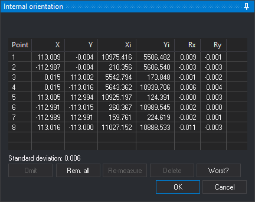

# INNER\_ORI\_L
<!-- id: ori-interna-i -->
<!-- origen: b15b8496da5d11157ffa7359d60b6de25cb82379 -->

INNER_ORI_L performs the **internal orientation** of the left image of the model loaded in the photogrammetric window. Internal orientation relates the camera calibration certificate's fiducial coordinates to the image's fiducial mark pixel coordinates. [INNER\_ORI\_R](/digi3d-ai/referencia/ventana-fotogrametrica/ordenes/o/ori-interna-d.md) performs the right image's internal orientation using the same pane.

## Parameters

None.

## Requirements

Displays an error balloon and ends in these cases:

* The model sensor is not the conical camera sensor.
* The image's camera is not analog: it has no fiducial marks.
* Existing internal orientation is read-only because the measured marks file could not be found.
* Another orientation command is running.

## Internal orientation pane

While the pane is open, Digi3D.AI displays the image being oriented to both eyes, sets zoom to 1 and disables the photogrammetric window's close button. The bottom of the pane identifies the fiducial mark to digitize. Press any mouse or input device button to record each mark.

If the image already has measured internal orientation, the pane opens with its measured marks. If it has no internal orientation and the other model image does, Digi3D.AI searches for each mark by correlation from the corresponding mark measured in the other image. The status bar shows **Correlating fiducial mark: N** and a percentage. If correlation fails to locate a mark, it stops, plays the error sound and displays a balloon with the mark number; the pane requests manual measurement of that mark and the following ones. If correlation finds all marks and **When correlating, go to the worst point** is enabled in configuration, the pane runs **Worse?**.

* **Clocks**: position of the clocks (**Left**, **Up**, **Right** or **Down**) in the image. Digi3D.AI uses it to position the cursor at the first two marks. Appears only before measuring the first mark and if the other image has no internal orientation. Changing it restarts measurement of all marks.
* **Mark list**: shows each mark's number (**Point**), fiducial coordinates (**X**, **Y**), measured pixel coordinates (**Xi**, **Yi**) and residuals (**Rx**, **Ry**) in fiducial coordinate units. In each of the **Rx** and **Ry** columns, Digi3D.AI shows in red the cells whose absolute value, rounded to the three decimals the cell shows, is the largest in the column (all tied cells), unless that value is 0. Click a mark to move the cursor to it. With **Re-measure automatically** enabled in configuration, Digi3D.AI also starts remeasuring the selected mark.
* **Standard deviation**: adjustment standard deviation in fiducial coordinate units. Shown once four marks have been measured.
* **Omit**: during mark measurement, skips the requested mark, excluding it from calculation. During remeasurement, cancels that measurement. Also runs with **Esc**.
* **Rem. all**: clears measured marks and starts measuring from the first.
* **Re-measure**: remeasures the selected mark. Disabled when **Re-measure automatically** is enabled. While the cursor moves, the list shows the residuals that the new position would produce.
* **Delete**: marks the selected mark as omitted: clears its measured coordinates and residuals and excludes it from calculation.
* **Worse?**: selects the mark with the largest residual and moves the cursor to it.
* **OK**: calculates internal orientation from the measured marks, saves it in `<imagen>.in.xml` in the work directory and ends the command. If the other model image has no internal orientation, assigns the calculated orientation to that image too. Enabled once all marks have been measured or omitted, with at least three measured. Also runs with **Ctrl+Enter**.
* **Cancel**: ends the command, retaining the image's internal orientation from when it started.

### Internal orientation calculation

* With two measured marks, Digi3D.AI calculates a provisional similarity transformation to position the cursor at subsequent marks.
* With three or more measured marks, calculates an affine transformation. This requires at least three noncollinear marks.
* If calculation is impossible, for example with three collinear marks, Digi3D.AI displays **The affine transformation needs at least three points that are not aligned, both in the source and in the destination points.** and retains the previous internal orientation. If this occurs when clicking **OK**, the pane remains open to remeasure or omit marks.

### Keys

| Button | Spanish keyboard | English keyboard |
| :--- | :--- | :--- |
| **Omit** | O | B |
| **Rem. all** | T | A |
| **Delete** | B | D |
| **Worse?** | P | W |

## Command characteristics

| Command type | Interactive command |
| :--- | :--- |
| Repeats automatically | No |
| Menu option | Photogrammetric window/Inner orientation (left) (option added by the conical camera sensor) |
| Toolbar | _This command has no associated toolbar button_ |
| Extension | Digi3D.ConicSensor.dll |
| Implementation | Native |
| Related variables | No related variables |
| Related commands | [ABSOLUTE\_ORI](/digi3d-ai/referencia/ventana-fotogrametrica/ordenes/o/ori-absoluta.md) [INNER\_ORI\_R](/digi3d-ai/referencia/ventana-fotogrametrica/ordenes/o/ori-interna-d.md) [RELATIVE\_ORI](/digi3d-ai/referencia/ventana-fotogrametrica/ordenes/o/ori_relativa.md) |
| Internal name | {DFA42290-2F06-4afe-B852-24447ECA6A89} |
