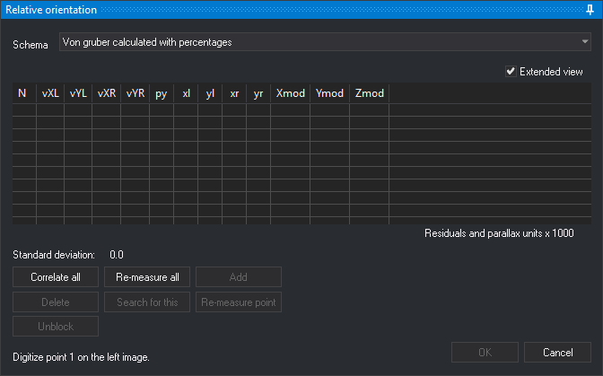

# RELATIVE\_ORI
<!-- id: ori-relativa -->
<!-- origen: 58979177b86e3a2e657b99cc387a6ee09d2ba650 -->

Performs the **relative orientation** of the model loaded in the photogrammetric window: calculates the right camera's position and rotations relative to the left camera from corresponding points measured in both images.

## Parameters

None.

## Requirements

Displays an error balloon or message and ends in these cases:

* Another orientation command is running.
* The model has an absolute orientation. To remeasure relative orientation, delete the absolute orientation file first.
* The current relative orientation cannot be modified.
* No Von Gruber schema file is specified under **Schemas** in the **Relative orientation** configuration category, or the file has a format error.

## Relative orientation pane

When opening the pane, if the model has no relative orientation and **Calculate overlap by correlation** is enabled in configuration, Digi3D.AI correlates the image centers to calculate overlap. The status bar shows **Calculating horizontal/vertical overlap**.

Measure each point in two steps, as indicated at the bottom of the pane:

1. Digitize the point in the left image. Digi3D.AI locks the left image and searches by correlation for its corresponding point in the right image.
2. Digitize the corresponding point in the right image. Press **Esc** to return to the first step for that point.

Digi3D.AI calculates relative orientation once the number of measured points reaches **Points to calculate** in configuration (5 by default), and recalculates it with each new point. With one measured point, adjusts a provisional orientation that eliminates parallax at that point.

* **Schema**: Von Gruber pattern with approximate positions of the requested points, read from the schema file. Digi3D.AI remembers the selected schema. Changing it clears measured points. Disabled if the model already had a calculated relative orientation.
* **Extended view**: adds each point's photo coordinates in the left image (**xl**, **yl**) and right image (**xr**, **yr**), and model coordinates (**Xmod**, **Ymod**, **Zmod**). Digi3D.AI remembers this setting.
* **Point list**: shows each point's number (**N**), left-image residuals (**vXL**, **vYL**), right-image residuals (**vXR**, **vYR**) and Y parallax (**py**). Residuals and parallax are multiplied by 1000, as indicated by **Residuals and parallax units x 1000**. When there are as many points as the **Points to calculate** configuration option specifies, Digi3D.AI shows in red, in each of the **vXL**, **vYL**, **vXR**, **vYR** and **py** columns, the cells whose absolute value, rounded to the three decimals the cell shows, is the largest in the column (all tied cells), unless that value is 0. Click a point to move the cursor to it. With **Re-measure automatically** enabled in configuration, Digi3D.AI also starts remeasuring it.
* **Standard deviation**: relative orientation standard deviation, multiplied by 1000.
* **Correlate all**: opens [Automatic relative orientation by correlation](/digi3d-ai/referencia/cuadros-de-dialogo/orientacion-relativa-automatica-por-correlacion.md), which measures points by correlation. Afterwards, the list contains the correlated points used in the calculation.
* **Re-measure all**: clears measured points and requests them again from the first.
* **Add**: requests a new point at the current cursor position. Enabled when all points have been measured.
* **Delete**: removes the selected point and recalculates the orientation.
* **Search for this**: while waiting for the right-image point, searches by correlation for the point corresponding to the one measured in the left image. Plays the error sound if the correlation factor is below **Correction factor** in configuration.
* **Re-measure point**: remeasures the selected point. Requires all points to have been measured.
* **Unblock**: while measuring a point, returns to the previous step and unlocks the left image. Equivalent to **Esc**.
* **OK**: saves relative orientation in the model's relative orientation file and ends the command. Enabled with enough points to calculate it. Also runs with **Ctrl+Enter**.
* **Cancel**: ends the command, retaining the model's relative orientation from when it started.

### Keys

| Button | Spanish keyboard | English keyboard |
| :--- | :--- | :--- |
| **Re-measure all** | R | R |
| **Add** | A | A |
| **Search for this** | B | S |
| **Re-measure point** | P | P |

## Command characteristics

| Command type | Interactive command |
| :--- | :--- |
| Repeats automatically | No |
| Menu option | Photogrammetric window/Relative orientation (option added by the conical camera sensor) |
| Toolbar | _This command has no associated toolbar button_ |
| Extension | Digi3D.ConicSensor.dll |
| Implementation | Native |
| Related variables | No related variables |
| Related commands | [ABSOLUTE\_ORI](/digi3d-ai/referencia/ventana-fotogrametrica/ordenes/o/ori-absoluta.md) [INNER\_ORI\_R](/digi3d-ai/referencia/ventana-fotogrametrica/ordenes/o/ori-interna-d.md) [INNER\_ORI\_L](/digi3d-ai/referencia/ventana-fotogrametrica/ordenes/o/ori-interna-i.md) |
| Internal name | {98028607-1205-45ec-9982-DEDE56BE9B6F} |
